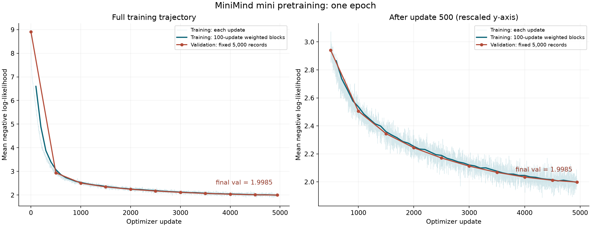

# 第 7 周：真实语料预训练实验

> 正式一个 epoch 已于北京时间 2026-10-26 02:56:35 完成；验收、结果分析、归档及原生 FP32 导出完成，本地新进程加载对照通过。发布前初查与模型卡草稿已整理；许可决策、独立恢复文件备份及 HF 发布尚未完成。

## 1. 本周目标与流程

### 1.1 学习目标

1. 对齐 MiniMind-3 Dense 的结构、初始化与数值计算。
2. 从真实语料构造训练集和验证集，冻结数据与编码规则。
3. 确定训练配方，通过短跑验证资源成本和暂停恢复。
4. 完成一个 epoch 的预训练，核对结果、成本和可恢复产物。

### 1.2 完成标准

- 训练：4,943 次更新，提交 1,265,235 条样本、301,810,690 个有效 target token。
- 验证：使用固定的 5,000 条记录，最终 token 加权 NLL 低于初始化时的 NLL。
- 工程：合同、日志、checkpoint 与 receipt 可追溯，恢复检查通过。
- 分析：说明实验支持什么结论、有哪些限制，不以 NLL 下降代替事实、推理或对话能力评测。

### 1.3 章节顺序

| 章节 | 要完成的工作 | 交给下一步的产物 |
| --- | --- | --- |
| 2 | 对齐目标模型 | 模型配置、实现与数值对照报告 |
| 3 | 检查来源、抽样分析、人工复核 | 固定来源、长度依据、复核决定 |
| 4 | 构造正式切分并审计编码 | JSONL、manifest、编码报告 |
| 5 | 接受并冻结数据版本 | 数据合同与数据冻结清单 |
| 6 | 确定候选训练配方并预检 | 候选 JSON、解析合同与预算 |
| 7 | 验证连续训练与暂停恢复 | 短跑结果、恢复比较与成本证据 |
| 8 | 冻结最终训练配方 | 最终配置、训练合同与冻结清单 |
| 9 | 启动正式训练 | 后台进程、启动记录与实时日志 |
| 10 | 观察运行，必要时恢复 | 周期验证、有效恢复点与运行记录 |
| 11 | 验收与归档 | 最终结果、成本分析与文件备份 |

第 12 节集中整理学习问答。统一路线见[实践路线](../PRACTICE_ROADMAP.md)。

### 1.4 执行约定

本文命令均在 [implementation](../implementation/) 目录的 PowerShell 中运行。先阅读每步的输入、实现和验收，再执行命令。

- 已有数据先核对身份，不重复下载或覆盖。
- 复练使用新的输出目录；文中的正式运行 ID 已在使用。
- 数据构造、审计、冻结和训练是独立入口，不会因运行一次训练脚本就全部自动完成。
- 本轮已完成。第 9～10 节保留启动与运行方法用于复练，不能对已完成的同名运行重复启动；实际完成状态与当前分析见第 11 节。


## 2. 模型结构与数值对齐

本章先解决“要训练哪一个模型”。结构相同还不够：初始化、运算精度和浮点顺序也会影响训练。完成本章后，再用这份模型配置设计数据和设备上的训练实验。

### 2.1 参考版本与目标配置

本轮以 MiniMind-3 Dense 的结构和官方 mini 数据路线为参照，从随机初始化完成预训练，再进入 SFT。少量数据短跑用于测量与排错；mini 正式训练采用的数据范围另行冻结。当前不将复现目标扩展为完整大数据重训，也不声称轻量训练能够达到官方最终发布模型的全部能力。

本轮固定官方源码提交 `f659b55761b754d306bd140573493a6543cafd7f`，发布配置固定到 HF revision `f92512d4cd6142fa9acc0d6022375049a8974bf6`。2026-10-24 查询时，官方 master 仍指向上述源码提交。

对照入口按职责区分：

- [模型与配置](https://github.com/jingyaogong/minimind/blob/f659b55761b754d306bd140573493a6543cafd7f/model/model_minimind.py)：结构和计算顺序。
- [预训练入口](https://github.com/jingyaogong/minimind/blob/f659b55761b754d306bd140573493a6543cafd7f/trainer/train_pretrain.py)：训练循环与脚本默认值。
- [数据编码](https://github.com/jingyaogong/minimind/blob/f659b55761b754d306bd140573493a6543cafd7f/dataset/lm_dataset.py)：截断、特殊 token 与监督位置。
- [训练工具](https://github.com/jingyaogong/minimind/blob/f659b55761b754d306bd140573493a6543cafd7f/trainer/trainer_utils.py)：辅助训练逻辑。
- [发布模型配置](https://huggingface.co/jingyaogong/minimind-3/blob/f92512d4cd6142fa9acc0d6022375049a8974bf6/config.json)：核对实际发布模型的结构。

源码默认参数不等于发布模型的完整训练记录。

| 项目 | 本轮采用的设置 | 验证方式 |
| --- | --- | --- |
| 模型尺寸 | hidden=768，FFN=2432，8 层；独立参数 63,912,192 | 装配正式模型并统计参数 |
| 词表与输出 | vocab=6400，Embedding/LM head 共享 | 检查共享 Parameter 身份 |
| 注意力 | Q 头 8、KV 头 4，head_dim=96 | GQA 组件与完整模型检查 |
| Q/K Norm | 拆头后、RoPE 前做 RMSNorm，显式启用 | 检查每层接线、前向与梯度 |
| RMSNorm | epsilon=1e-6，按官方乘 rsqrt 的运算顺序 | 相同权重下数值对照 |
| RoPE | theta=1e6，前后半特征配对；角度用 FP32 | 位置精度、输出 dtype 与梯度检查 |
| 初始化 | Linear/Embedding 正态分布 std=0.02，norm 缩放为 1 | 统计检查；正式启动另核对实际初始化哈希 |
| 计算骨架 | Pre-Norm、Attention 残差、SwiGLU 残差 | CPU FP32 完整模型对照 |

这些是已落到实现中的设置。下面按当时的修改顺序讲解怎样得到它们；每个小节末尾的日期和测试结果属于该步证据，不表示当前还停留在那个阶段。

本地两个 tokenizer JSON 与冻结源码的解析内容相同，差异仅为 CRLF/LF 换行。因此要分别记录上游和本地的实际字节身份：

| 文件 | 本地 SHA256 | 上游 SHA256 |
| --- | --- | --- |
| tokenizer.json | `8bf5868abfc7ea919186b57e2b411adefe3b0922b53052c5839937e166b9d395` | `71f32c68cf63a15355a8fc171b7594b3d41870fe0ddb54fc6aefa55f73a4a668` |
| tokenizer_config.json | `e42b762555734279158ca292431c831fa387c48c35d9b1b205f4fc6c83b79d34` | `d7cd6a60c9f191c4f9ffec69b2eb289ad2f960366724f328b681ae1e46e4c110` |

资产 manifest 记录上游哈希，数据 manifest 记录实际本地哈希，两者不能混用。本次不因换行差异更换 tokenizer，也不重做已完成的长度分析。

### 2.2 拆头后的 Q/K 归一化

Q、K 经过线性投影并拆头后，分别为 `[B,T,Hq,d]` 与 `[B,T,Hkv,d]`。Q/K Norm 在每个位置、每个头内部，对最后的 d 个特征做 RMSNorm，形状不变，然后再应用 RoPE。它使进入点积的 Q/K 尺度得到归一化控制；归一化后的向量仍包含方向信息，且有可学习缩放权重。它不替代 block 输入的 RMSNorm：前者作用于投影后的头特征，后者作用于投影前的 hidden 特征。

~~~text
hidden states → block RMSNorm → Q/K/V 投影 → 拆头
                                         ↓
                                Q Norm / K Norm
                                         ↓
                                    RoPE(Q,K)
                                         ↓
                           KV 头扩展 → 点积、mask、Softmax
                                         ↓
                                    汇总 V → O 投影
~~~

#### 2.2.1 实现位置与配置

在 [attention.py](../implementation/src/minimind_lab/models/attention.py) 的 GroupQueryAttention 中实现本步。为保留前四周不带 Q/K Norm 的教学行为，构造参数新增 `qk_norm: bool = False` 与 `rms_norm_eps: float = 1e-6`；启用时创建两份独立的 `RMSNorm(self.head_dim, eps=rms_norm_eps)`，关闭时使用 `nn.Identity()`。在 q_split、k_split 生成后，分别交给 self.q_norm、self.k_norm，再沿已有流程前进；V 保持原流程。

这一步先在 Attention 内实现并独立检查。启用开关和 epsilon 在后续通过 ModelConfig、DecoderBlock、Backbone 接通，正式 MiniMind-3 配置显式启用；当前不改所有教学模型的默认结构。新增参数不会自动应用到既有 checkpoint，正式训练和恢复必须核对结构身份。

#### 2.2.2 验证条件

验证时使用小尺寸配置，确认三点：开关关闭时旧计算行为保留；启用后 Q/K Norm 的权重长度为 head_dim 且获得梯度；固定投影和 norm 权重后，输出与手工按“拆头、归一化、RoPE、注意力”组合的参考一致。仅检查输出 shape 无法发现归一化放错轴或放错位置。

#### 2.2.3 实践记录

2026-10-24，学习者完成 Attention 内的开关与 Q/K Norm，过程中遇到两类问题：

- SingleHeadSelfAttention 中误加了未参与 forward 的 norm，无梯度检查捕获后删除；相关测试 50 passed。
- 参数从 res_norm_eps 改名为 rms_norm_eps 时，启用分支残留旧变量名；默认关闭的旧测试未覆盖此分支，需要显式启用才能发现。

修正后，助手用 hidden=16、Q=4、KV=2 单独检查：输入和输出均为 `[2,3,16]`，权重为 `[2,4,3,3]`，两份 norm 权重均为 `[4]`，梯度有限且非零。固定非单位 norm 权重的手工参考也通过。

当时这项检查为临时核验，完整模型接线与正式回归在下一节继续完成。

### 2.3 配置接线与完整模型检查

Attention 已有实现，但完整模型创建每层 Attention 时还没有传入开关，因此仍默认关闭。接线沿 `ModelConfig → MinimindBackbone → DecoderBlock → GroupQueryAttention` 推进。配置只在构造模块时生效；模型创建后修改 config 对象，不会自动重建 norm。

1. 在 [config.py](../implementation/src/minimind_lab/models/config.py) 的 ModelConfig 中新增 `qk_norm: bool = False`。保留已有 rms_norm_eps 字段；正式配置显式选择 1e-6。
2. 在 [block.py](../implementation/src/minimind_lab/models/block.py) 的 DecoderBlock 构造参数末尾新增 `qk_norm: bool = False`，创建 GroupQueryAttention 时显式传入 `qk_norm=qk_norm` 与 `rms_norm_eps=eps`。这样 Attention 头内 norm 与 block norm 都取同一份配置 epsilon。
3. 在 [model.py](../implementation/src/minimind_lab/models/model.py) 的 MinimindBackbone 创建每层 DecoderBlock 的位置新增 `qk_norm=config.qk_norm`。

#### 2.3.1 接线验证

先用小尺寸模型验证配置传递，避免把模块接线与正式训练预算混为一项：

~~~python
config = ModelConfig(
    vocab_size=32,
    hidden_size=16,
    intermediate_size=32,
    num_layers=2,
    num_heads=4,
    kv_heads=2,
    rms_norm_eps=1e-6,
    qk_norm=True,
)
model = MinimindForCausalLM(config)
~~~

验收时遍历两层 block，确认 q_norm、k_norm 都为 RMSNorm，eps 取自 config，权重长度为 4，并运行完整模型前向和反向；默认配置仍保持关闭。该检查验证的是每层正确接到配置，正式 8 层尺寸、初始化与官方完整模型数值对齐另行完成。

#### 2.3.2 实践记录

2026-10-24，学习者完成三处接线。过程中修复 DecoderBlock 重复定义 eps 的语法错误，并补上 Backbone 到 Block 的 qk_norm 传参。助手在 [test_model.py](../implementation/tests/test_model.py) 增加开关两种模式的完整模型测试，检查每层类型、head_dim 权重长度、epsilon 传递、带 padding 的 causal-LM loss 与反向梯度。测试特意使用 3e-4，区别于 Attention 的默认 1e-6，防止遗漏 epsilon 传参仍误通过。

两层 Q/K Norm 参数均获得有限且非零梯度；相关配置、Block、模型与 Attention 测试合计 88 passed。本步核心修改由学习者完成，新增回归测试由助手完成。

### 2.4 正式模型尺寸检查

配置开关接通后，再装配正式尺寸，检查参数量与模块数量。此时只在 CPU 上构造模型，不进行训练；尚未对齐的初始化与计算精度留在下一步处理。

#### 2.4.1 装配与检查

在 implementation/scripts 新建 inspect_minimind3.py，导入 ModelConfig 和 MinimindForCausalLM，使用以下显式配置构造模型：

~~~python
config = ModelConfig(
    vocab_size=6400,
    hidden_size=768,
    intermediate_size=2432,
    num_layers=8,
    num_heads=8,
    kv_heads=4,
    rms_norm_eps=1e-6,
    rope_base=1e6,
    qk_norm=True,
)
~~~

打印 len(model.backbone.blocks)、第一层 attention.head_dim、sum(p.numel() for p in model.parameters())，并用 is 检查 lm_head.weight 与 backbone.embedding.weight 是否为同一对象。预期依次为 8、96、63,912,192、True。model.parameters() 默认对共享 Parameter 去重，因此统计独立参数时不会重复计算共享词表权重。

~~~powershell
uv run --locked python scripts/inspect_minimind3.py
~~~

#### 2.4.2 结果与范围

2026-10-24，学习者完成 [inspect_minimind3.py](../implementation/scripts/inspect_minimind3.py)，用四个 assert 检查上述条件。助手实际运行退出码为 0，无打印输出，说明全部断言通过；另行打印核实了 8、96、63,912,192、True。结构和参数量相同，不代表初始化、完整前向数值或训练结果已经与官方一致。

### 2.5 完整模型初始化

模型尺寸确认之后，需要明确参数从什么分布开始。当前 TokenEmbedding 构造时使用 torch.rand，完整模型也尚未调用第三周写过的 initialize_weights。2026-10-24 助手实际观察到目标模型 Embedding 均值约 0.50016、标准差约 0.28858，符合当前均匀分布的量级；该次未固定随机种子，数值只用于说明当前初始化来源。

现有 [initialization.py](../implementation/src/minimind_lab/models/initialization.py) 已实现 Linear/TokenEmbedding 权重使用均值 0、标准差 0.02 的正态分布，RMSNorm 的可学习缩放初始化为 1。冻结官方源码在 post_init 中使用 Transformers 的初始化；当前锁定 4.57.6 的 PreTrainedModel._init_weights 已核对为同类分布。相同分布不保证相同 seed 下参数逐元素相同，创建与遍历顺序、共享权重都影响随机数消费。

#### 2.5.1 接入初始化

在 [model.py](../implementation/src/minimind_lab/models/model.py) 导入 initialize_weights，在 MinimindForCausalLM.__init__ 的权重共享语句后调用 `self.apply(initialize_weights)`。放在完整装配之后，确保 Embedding、所有 block、最终 norm 和 LM head 都已经注册；重新初始化只在新模型构造时执行，恢复 checkpoint 应在构造之后加载保存的权重。

Module.apply 遍历模块而非独立参数，因此共享 Embedding/LM head 的同一张表可能被初始化两次，最终仍是同一 Parameter 且服从所选分布，但随机数消费不会自动对齐官方。后续前向数值对照通过显式映射相同权重建立共同输入条件，不能仅靠设置同一个 seed。

#### 2.5.2 验证与结果

修改后，在 inspect_minimind3.py 增加 Embedding 与第一层 q_proj 权重的均值/标准差打印；预期均值接近 0，标准差接近 0.02，原来四项结构断言继续通过。不要断言样本均值精确为 0 或样本标准差精确为 0.02。

学习者已把 initialize_weights 接入完整模型构造并增加 Embedding 统计。助手运行得到一次均值约 7.36e-6、标准差约 0.02000746，四项结构断言通过。科学计数法中的 e-6 表示乘以 10 的负 6 次方，7.36e-6 约为 0.00000736；指定的是抽样分布的均值，不要求有限权重样本的平均值精确等于 0。2026-10-24 初始化修改后的全项目回归为 257 passed，用时约 28.82 秒；尚未执行真实训练。

### 2.6 RoPE 角度计算精度

参数存储、运算类型、敏感统计、梯度与优化器状态的整体关系见[训练数值精度与混合精度](../../../../model_architecture_and_algorithms/03_optimization/02_NUMERICAL_PRECISION_AND_MIXED_PRECISION.md)。下面保留本案例的修改顺序和验证证据。

目前 GQA 使用 q_trans.dtype 创建 RoPE 位置与频率；FP32 组件测试时没有问题，但混合精度训练的投影输出可能为 BF16。BF16 能表示很大范围的数值，但有效精度较低，不能精确表示所有较大的连续整数。2026-10-24 助手在当前环境实际检查：FP32 的位置 255 至 259 为 `[255,256,257,258,259]`，同一段 BF16 张量转回 FP32 后是 `[255,256,256,258,260]`。转回 FP32 不能找回创建时丢掉的精度。

对 seq_len=768、head_dim=96 的角度表，第一组频率为 1，位置 257 的角度在 BF16 路径得到 256，而 FP32 路径是 257。这是进入三角函数前的误差，因此需要先用足够精度的位置与频率计算角度。冻结官方实现使用 FP32 预计算 RoPE，不随投影输出降到 BF16。

#### 2.6.1 修改位置

本步分两处修改：

1. 在 attention.py 的 GroupQueryAttention.forward 中，build_rope_angles 的 dtype 改为 `torch.float64 if q_trans.dtype == torch.float64 else torch.float32`，device 仍沿用 q_trans.device。正式训练使用 FP32 计算角度；现有 FP64 数值对照继续保留较高精度。
2. 在 rope.py 的 apply_rope 中，把 rotate_features 的结果分别转换回对应输入的 dtype：`rotate_features(q, angles).to(dtype=q.dtype)` 和 `rotate_features(k, angles).to(dtype=k.dtype)`。这样角度与旋转的中间计算可用 FP32，传给后续 Attention 的 Q/K 仍使用各自原精度。

#### 2.6.2 验证条件与结果

本步不修改通用 build_rope_angles 的 dtype 接口；由模型调用方选择适合训练的角度精度。apply_rope 的 dtype 转换仍在计算图中，不能加入 detach 或 no_grad；反向传播应继续到达 Q/K 投影参数。验收需要同时覆盖原 FP32/FP64 测试，以及 BF16 输入的角度精度、输出 dtype 与反向梯度。

2026-10-24，学习者完成两处精度修改。助手先运行既有相关测试 78 passed，再独立核验 BF16 的 RoPE/GQA 路径，并在 test_rope.py 与 test_attention.py 保存两项回归：位置 257 的 FP32 角度、已知向量的旋转结果、输出恢复 BF16、Q/K 与投影参数的有限梯度。新增后的 RoPE、Attention、padding 和完整模型相关测试合计 80 passed。该次 BF16 检查在 CPU 执行，尚未验证 CUDA autocast 的完整训练过程。

### 2.7 Attention 分数与 Softmax 精度

RoPE 的输出恢复成 Q/K 原精度后，注意力点积结果在低精度运行时也可能是 BF16/FP16。冻结官方手写路径在点积后转 FP32，再缩放、加 mask 和计算 Softmax，之后把权重转回低精度再汇总 V。本地目前跟随分数原精度，下一步对齐这个处理。

#### 2.7.1 实现步骤

在 attention.py 的 scaled_dot_product_attention 中，把原来的缩放点积一行展开为：

~~~python
scaled_scores = q @ k_t
if scaled_scores.dtype in (torch.float16, torch.bfloat16):
    scaled_scores = scaled_scores.float()
scaled_scores = scaled_scores / (q.shape[-1] ** 0.5)
~~~

后续 mask 和 Softmax 沿已有流程。汇总 V 的一行改为 `output = weights.to(dtype=v.dtype) @ v`。返回的 weights 保留 Softmax 计算精度；output 继续交给后续模型处理。FP64 对照不降精度，FP32 路径不需要额外转换。

#### 2.7.2 精度边界与验证

这一步提高的是点积结果之后的缩放、mask 和 Softmax 精度；点积本身仍可能由 autocast 低精度执行，事后转 FP32 不会恢复点积阶段已损失的精度。完成后检查低精度输入的返回权重为 FP32、输出与 V 原精度兼容、因果与 padding 规则不变，以及参考前向与反向。

2026-10-24，学习者完成两处修改。助手验证 BF16/FP16 下权重为 FP32、输出恢复 V dtype、mask 禁止位置为零、行权重和接近 1，输入梯度有限。与原生 SDPA 的输出最大差分别为 0.0078125 和 0.0009765625；中间舍入不同，使用对应低精度容差比较。两种 dtype 的回归加入 test_attention_padding.py，相关 RoPE、Attention、padding 与模型测试 82 passed。本次仍在 CPU 执行，未验证 CUDA 混合精度训练。

### 2.8 相同权重下的官方数值对照

独立组件通过后，使用完整模型检查它们的组合。相同 seed 不保证两套实现的参数相同，因为模块创建、初始化顺序与共享权重会改变随机数消费。先将官方 state_dict 映射到本地命名，严格加载并检查参数集合，再送入相同 input_ids、attention_mask 和 labels。

#### 2.8.1 对照方法

[compare_minimind3_reference.py](../implementation/scripts/compare_minimind3_reference.py) 由助手实现，加载并校验冻结官方源码，在 CPU FP32 下关闭 Flash 路径、dropout 与 KV cache。先比较 logits、causal loss，再分别 backward，比较每份独立参数的梯度。Q/K Norm 的缩放刻意使用非单位值，检查缩放是否真正参与计算。

~~~powershell
uv run --locked python scripts/compare_minimind3_reference.py --profile tiny --output-dir runs/alignment_tiny_recheck
uv run --locked python scripts/compare_minimind3_reference.py --profile dense --output-dir runs/alignment_dense_recheck
~~~

每次使用新输出目录。tiny 为两层 hidden=16；dense 为正式 8 层 hidden=768。本次只用两条 4-token 序列检查无 padding 和右侧 padding。完整条件、结果及限制见[数值对照归档](../experiments/minimind3_alignment_cpu_fp32/README.md)。

#### 2.8.2 首次结果与定位方向

tiny 对照通过，logits 最大差约 2.98e-8、loss 差为 0、梯度最大差约 1.19e-7。dense 在预设 atol=1e-6、rtol=1e-4 下，有 6 个 logits 元素未满足容差，尚不能宣称正式尺寸对照通过。

### 2.9 RMSNorm 浮点运算对齐

正式尺寸暴露了数学等价但浮点计算顺序不同的地方：本地 RMSNorm 使用 x / sqrt(mean(x^2)+eps)，官方使用 x * rsqrt(mean(x^2)+eps)。微小舍入差经过 8 层组合后，少量接近零的输出超出预设容差。

助手在临时诊断中只把官方 RMSNorm 改为本地除法写法，保持其他条件不变，两组输入的 logits 差均变为 0。该结果帮助定位，修改过的参考不能用于正式验收；剩余梯度舍入与限制已归档。

#### 2.9.1 对齐实现

在 [rmsnorm.py](../implementation/src/minimind_lab/models/rmsnorm.py) 的 forward 中，将 scale_x 改为 `x_float * torch.rsqrt(x_float.pow(2).mean(dim=-1, keepdim=True) + self.eps)`。rsqrt 表示平方根的倒数；保留现有转 FP32、乘可学习权重和恢复输入 dtype 的步骤。

#### 2.9.2 最终对照结果

学习者完成修改后，助手重新运行未修改的官方源码对照，tiny/dense 均通过，容差保持 atol=1e-6、rtol=1e-4。正式尺寸两组输入的 logits 与 loss 差均为 0；90 份参数梯度的最大差分别约为 1.19e-6、1.45e-6，符合逐元素容差，不能称为梯度逐位相同。原始参考源码通过既有哈希校验，正式报告与修正后小尺寸报告均已归档。相关测试 82 passed，最终完整回归为 261 passed，用时约 26.34 秒。本次只验收 CPU FP32 的短输入计算路径，未验证 CUDA 混合精度训练与正式序列长度。

本章确认的是已测试条件下的结构与计算路径。接下来检查真实语料；目标模型能运行，不等于任何来源的数据都适合直接训练。

## 3. 来源检查、抽样与人工复核

本章先认识数据，再决定正式处理规则。顺序是固定来源、抽样观察、比较长度成本、复核内容。10,000 条候选用于分析；正式训练随后回到完整 mini 来源，不只训练这份抽样。

### 3.1 固定来源与文件身份

以下命令均在 [implementation](../implementation/) 目录的 PowerShell 中运行。

| 项目 | 本次输入 |
| --- | --- |
| 仓库 | jingyaogong/minimind_dataset |
| revision | 312afb4f76391145c6902f765bb51691c09a12f5 |
| 文件 | pretrain_t2t_mini.jsonl |
| 格式 | 一行一个 JSON 对象，正文在 text 字段 |
| 原文件大小 | 1,241,043,656 字节 |
| 物理行数 | 1,270,238 |
| 源 SHA256 | 6dd6716c84ab36897bdbfc7f88e04f4441c48c1ab7ecee88ce0b0e7d4685560c |
| tokenizer | assets/minimind_tokenizer |

来源说明见[固定版本数据卡](https://huggingface.co/datasets/jingyaogong/minimind_dataset/blob/312afb4f76391145c6902f765bb51691c09a12f5/README.md)。作者的清洗说明不代替本地核验。

~~~powershell
uv run `
  --locked hf download jingyaogong/minimind_dataset pretrain_t2t_mini.jsonl `
  --repo-type dataset `
  --revision 312afb4f76391145c6902f765bb51691c09a12f5 `
  --local-dir data/raw/minimind
Get-FileHash data/raw/minimind/pretrain_t2t_mini.jsonl -Algorithm SHA256
~~~

已有文件先核验身份，避免再次下载。完整数据和候选文件位于 Git 忽略目录，换机器要按来源恢复。

### 3.2 初步观察与监督方式

最初读文件头部 20 条，发现不同话题问答连续拼接、具体事实数值可疑等现象。头部样本不能代表整体，因此后续从全文件抽样。

Pretrain 管线对正文有效目标位置做下一个 token 预测，问题与回答都可参与监督。padding 被屏蔽，causal shift 在 loss 层执行。assistant-only SFT 同样预测下一个 token，但数据模板与监督位置不同。

### 3.3 固定抽样与候选落盘

#### 3.3.1 实现顺序

学习者实现 [prepare_pretrain_subset.py](../implementation/scripts/prepare_pretrain_subset.py)，复用 reader 与 validator：

1. 流式扫描统计行数；全部读完后检查抽样数量的范围。
2. 用独立 random.Random(42) 从 1 到总行数不放回选 10,000 个行号。
3. 排序行号，转为 set 供第二遍扫描做成员判断。
4. 对选中行检查 JSON 解析与 text 结构；有错就报告行号并停止。
5. 保存 source_line 与原始 text，数量一致后逐条写 JSONL。
6. 关闭文件，计算源文件与候选文件字节哈希，写 manifest。

~~~powershell
uv run --locked python scripts/prepare_pretrain_subset.py
~~~

预期选中及提取数量均为 10,000，第一条来源行号为 180。脚本会覆盖同名候选产物，变更来源或 seed 后应采用新版本目录并重建后续产物。

#### 3.3.2 产物与核验

~~~text
data/processed/pretrain_candidate_v1/
  candidates.jsonl
  manifest.json
~~~

候选 SHA256 为 471d2e48665b0d5c4e8e3da07c7b3cda2f486d1281426568a40192b8553fe73b。

已核验 10,000 个行号唯一、升序且与 seed 一致，候选正文逐条匹配源记录，两份哈希与 manifest 一致。这不表示全源文件通过结构或事实审计。

### 3.4 长度分布与成本比较

#### 3.4.1 原始长度统计

用 [inspect_pretrain_data.py](../implementation/scripts/inspect_pretrain_data.py) 对固定候选编码，设置 add_special_tokens=False、truncation=False，统计未截断正文的长度。不要从已经截断的 Dataset 反推原始长度。

~~~powershell
uv run --locked python scripts/inspect_pretrain_data.py
~~~

report.json 保存统计结果；分位数基于全部 10,000 条候选，使用 NumPy linear 插值。原脚本还会输出早期筛选清单，但本轮正式数据不据此删除长记录。

| 指标 | 结果 |
| --- | ---: |
| 正文 token 总数 | 2,584,015 |
| 平均正文长度 | 258.4015 |
| 最短 / 最长 | 6 / 6,287 |
| P50 / P90 | 210 / 414 |
| P95 / P99 | 557 / 约 1,416.03 |
| 完全重复的额外记录数 | 0 |

#### 3.4.2 候选长度与正式选择

[compare_pretrain_lengths.py](../implementation/scripts/compare_pretrain_lengths.py) 对同一份 10,000 条候选比较不同长度，并核对候选、tokenizer 与来源身份；[inspect_pretrain_source.py](../implementation/scripts/inspect_pretrain_source.py) 检查完整来源。再次执行需使用新的报告路径，不覆盖已有证据。

~~~powershell
uv run --locked python scripts/compare_pretrain_lengths.py --verify-source
uv run --locked python scripts/inspect_pretrain_source.py
~~~

下表采用“保留记录、只截尾”的统一口径，BOS/EOS 占两位：

| 最大长度 | 正文容量 | 完整容纳记录 | 截尾损失正文 tokens | 定长位置数 |
| ---: | ---: | ---: | ---: | ---: |
| 512 | 510 | 9,410，94.10% | 321,373，12.44% | 5,120,000 |
| 768 | 766 | 9,632，96.32% | 209,414，8.10% | 7,680,000 |
| 1,024 | 1,022 | 9,664，96.64% | 118,886，4.60% | 10,240,000 |

768 比 512 多保留约 4.95% 的候选正文 token，定长位置数增加 50%；1,024 又能保留更多内容，但增加计算与 padding 成本。覆盖率不是唯一依据，最终还需结合设备短跑。本轮接受的编码长度为 768，正文容量为 766。

早期曾做过“512 长度、超长记录整条排除”的小样本练习，现已归档于 [pretrain_512_v1](../experiments/pretrain_512_v1/README.md)，不作为正式训练输入。正式方案保留完整来源记录，在编码时截尾；下面的构造、合同和预算均沿用这一方案。

### 3.5 内容初筛与人工决定

#### 3.5.1 范围与分工

助手固定抽样并排版，学习者完成全部 12 条初筛，助手按用户明确委托补充复核与证据。抽样来自正文不超过 510 tokens 的 9,410 条，使用 seed=20261021 不放回抽 12 条。该结果不代表长度被排除部分。

本地原文和学习者初筛保留于 implementation/data/processed/pretrain_candidate_v1/analysis/content_review.md，机器可读处理记录在同目录 review_decisions.jsonl。下表保留关键结论，避免仅有忽略目录中的临时记录。

| 来源行 | 初筛 | 复核 | 关键依据 |
| ---: | --- | --- | --- |
| 356 | 保留 | 保留 | 建站指导基本连贯，部分路径描述偏绝对 |
| 24789 | 待核实 | 排除 | 算式等于 59，答案写 61，后续推导又为 59 |
| 463046 | 排除 | 排除 | 情境与补充信息边界不清，因果依据不足 |
| 500450 | 保留 | 保留 | 咨询对话连贯，书目贴合度有限 |
| 674454 | 待核实 | 保留 | 建议中的保证性措辞属于轻微质量问题 |
| 817876 | 保留 | 保留 | 建议与请求相关，未验证营销收益 |
| 826594 | 保留 | 保留 | 虚构对话基本连贯，偏模板化 |
| 858799 | 待核实 | 排除 | 精确日期与官方主席当选公报不一致 |
| 869146 | 保留 | 保留 | 虚构对话基本相关，信息密度有限 |
| 871597 | 保留 | 保留 | 新增虚构情节未与前置设定明显冲突 |
| 1025075 | 保留 | 保留 | 分类与汇总数量内部一致 |
| 1200854 | 待核实 | 保留 | 短文与总结对应，较短不自动排除 |

#### 3.5.2 复核理由与证据

算术矛盾可在文本内部验证，无须先查完历史段落。第 3 条不是两种原因必然矛盾；后半若是推断则缺少因果证据，若是新增虚构设定则未必错误。本次保守排除任务边界含糊的记录，不宣称因果陈述已被证明为假。

IPCC 样本的西班牙语为“谁是 IPCC 第一任主席？”，与背景相关；混合语言与没有答案不自动使 Pretrain 文本无效。但原文精确给出 2015-10-08 起任，官方 [2015-10-06 当选公报](https://www.ipcc.ch/site/assets/uploads/2018/04/151006_election_of_new_chair.pdf)记载主席选举于 6 日，其他职位选举延续至 8 日。本次据日期不一致排除，仅核查列明的主张。

复核共 9 保留、3 排除，不是全语料事实错误率。随后将决定应用到训练/验证构造，候选正文未修改。“保留”只表示本轮没有足以排除的问题，不表示事实全面正确。

#### 3.5.3 人工约束的用途

数据可以继续用于有限预算的训练工程与同分布预测实验；验证文本也可能含错，NLL 改善不能证明事实或推理更可靠。若目标升级为可靠知识能力，应改进数据方案并使用独立可靠评测。

切分时，3 条排除记录不进入训练或验证；9 条已经内容审查和讨论的保留样本只进入训练或开发材料。规则选择完成后再冻结验证集。其他记录未逐条核实，完全重复为零不保证没有相似或同源内容。

### 3.6 本章交付

- 原始文件及固定版本来源清单。
- 10,000 条候选、长度报告和内容观察。
- 12 条人工决定：3 条排除，9 条保留但只用于训练。

人工决定保留在[复核记录](../experiments/pretrain_512_v1/review_decisions.jsonl)。它虽产生于早期练习，正式构造仍按正文与来源身份核验后继承；下面不重新抽一批样本来替换已有决定。


## 4. 正式文本切分与编码审计

本章把完整来源变成模型可用的数据版本，分两步完成：

1. **文本构造**：应用人工约束，按正文组划分训练和验证，保留原始正文。
2. **编码审计**：使用固定 tokenizer 和长度规则，检查实际 token 输入、有效目标和跨集合重合。

两个入口各司其职，不启动模型训练：

~~~text
build_pretrain_mini.py
  → publish_mini_dataset：核对来源身份
    → build_mini_dataset
      → collect_text_groups：正文分组
      → load_review_constraints：人工约束
      → select_validation_groups：选验证组
      → write_split_records：写出记录
    → 核对计数与身份，最后写 manifest

audit_pretrain_encoding.py
  → 核对同一文本切分与 tokenizer
  → audit_encoding：模拟实际编码、检查重合、统计 token
  → 写出与这份切分绑定的编码报告
~~~

### 4.1 完整来源核验

抽样帮助我们认识数据，正式切分则扫描完整 mini 来源，不以 10,000 条候选替代。先核对来源身份和结构，再应用已确定的分组、人工约束与验证抽样规则。

助手运行 [inspect_pretrain_source.py](../implementation/scripts/inspect_pretrain_source.py)，复用 reader 与 validator，重新核对原文件哈希并逐行检查完整来源。结果为 1,270,238 行全部结构通过，所有记录只有 text 字段。按原始正文 SHA256 统计，有 1,270,047 个不同正文，191 组完全重复文本，每组两条。报告见[正式数据准备归档](../experiments/pretrain_mini_one_epoch_v1/evidence/data_preparation/README.md)。这不是全量事实核查，也没有识别原始文档或近似重复。

### 4.2 切分与验证集设计

#### 4.2.1 文本与编码边界

训练文件保存原始 text 和 source_line，不提前永久裁短正文。Dataset 编码时按长度 768 保留前 766 个正文 token，加 BOS/EOS，再由 collator 右侧 padding。若更换长度或 tokenizer，需要重新审计实际输入，不能沿用旧统计。

#### 4.2.2 分组与泄漏边界

切分单位是原始正文 UTF-8 的 SHA256。同一正文的全部来源行必须进入同一集合。本轮保留组内重复记录的训练权重，不另做“每组只保留一条”的去重处理。

隔离要区分三个层次：

1. **记录身份**：来源行不能同时进入训练和验证。
2. **精确内容**：相同正文不跨集合；截断后相同 token 输入也要检查。
3. **同源与相似内容**：同一文档、对话的派生片段或近似重复不跨集合。

本次实现前两层检查。原始来源只有 text，source_line 不是文档 ID，因此不能声称已经完成第三层。有可靠文档、对话或任务 ID 时，应先分组，再切块或派生样本，避免相邻内容泄漏。

#### 4.2.3 分布、规模与成本

本轮验证用于观察同来源文本的预测变化，所以从采用相同处理规则的正文组中固定留出验证数据。跨领域、跨时间等泛化问题需要另设对应评测，不能由这份验证 NLL 回答。

从符合约束的不同正文组中按 seed=43 抽取 5,000 组；实际抽中的组各有一条，得到 5,000 条验证记录、1,206,758 个有效 target。不能在构造前就把“组数”当成“记录数”，因为原始分组中有重复正文。

规模不是照搬某个比例，而是在覆盖和运行成本之间选择。记录占比也不等于 token 占比，长记录对 token 加权 NLL 的贡献更大。本次保存了长度与 token 统计，尚未系统检验主题、语言和质量配比，不宣称代表性已被充分证明。

整份验证集大小、每次评估量和频率是三个选择。本轮每次遍历全部 5,000 条，具体频率与实测成本见第 6.3.3 节。若将来比较微小 NLL 差异，应保留逐记录 loss_sum/target 数做配对分析，必要时按记录或来源组估计抽样不确定性；不能把同一文本内的所有 token 当作独立观测，也不能把它与多 seed 的训练波动混为一谈。本轮未作这类显著性判断。

#### 4.2.4 验证用途与选择约束

这份验证集用于开发监控，可以观察曲线和比较 checkpoint；它不是未参与任何选择的独立最终测试集。若反复调参并挑选最优验证分数，最终能力仍需另设独立测试。

用于讨论清洗规则的 12 条记录采用保守安排：3 条排除，9 条保留但只进训练。train_only 只限制这些特定正文的用途，不表示训练集只有它们。

不能根据某个 checkpoint 的得分删除困难验证记录、换抽样 seed 或改计分规则。发现真实数据错误时，应更新数据版本并重新评估受影响的对照。即使分布和隔离都合理，错误参考文本仍可能被模型更好地拟合；NLL 不代替事实与推理能力评测。

这些约束确定之后，下面依次实现分组、约束读取、验证组选择与文件发布。

### 4.3 正文分组

在 [build_pretrain_mini.py](../implementation/scripts/build_pretrain_mini.py) 中实现 `collect_text_groups(source_path: Path) -> dict[str, list[int]]`。复用 iter_jsonl 与 validate_pretrain_record；遇到结构错误报告来源行并停止。对原始 text 的 UTF-8 内容计算 SHA256 十六进制字符串，将 source_line 加入对应列表，不把所有正文保存在内存。

这段的返回值用于后续按组选择验证数据，然后再扫描原文件写出对应正文。当前源码检查表明，它应得到 1,270,047 个键，列表长度合计 1,270,238；191 个列表长度为 2，其余为 1。实现时暂不创建训练/验证输出，也不在此处截断文本。

验证时先用“相同正文、另一正文、相同正文”的三行样本，确认第 1、3 行进入同一个列表且没有被删除。再检查无效 JSON、缺失正文或空正文会报告行号并停止；validator 返回错误列表，调用者必须明确抛出异常，打印错误后继续处理并不算拒绝输入。最后才扫描完整来源，与独立来源检查的组数和记录数比较。本次结果一致，回归保存于 [test_pretrain_mini.py](../implementation/tests/test_pretrain_mini.py)。

### 4.4 读取人工约束

分组之后，先把已有决定转换成组级约束，再选择验证组。第 3.5 节的 12 条决定已经落盘，不重新进行人工审查；其中文本身份可直接对应 text_groups 的键。

继续在 build_pretrain_mini.py 实现：

~~~python
def load_review_constraints(
    review_path: Path,
    text_groups: dict[str, list[int]],
) -> tuple[set[str], set[str]]:
~~~

返回顺序为 excluded_hashes、train_only_hashes，保存正文 SHA256。输入路径可使用[已归档的 review_decisions.jsonl](../experiments/pretrain_512_v1/review_decisions.jsonl)。处理顺序如下：

1. 复用 iter_jsonl 检查每一行解析结果；解析错误立即报告并停止。
2. 取 text_sha256，确认它存在于 text_groups，并确认 review 的 source_line 属于该组，避免把决定应用到错误正文或来源行。
3. decision=exclude 且 allowed_split=exclude_all 时加入 excluded_hashes；decision=keep 且 allowed_split=train_only 时加入 train_only_hashes；其他组合报错。
4. 读完后检查两个集合互不交叉，存在冲突则停止，再返回两个集合。

现有输入得到 3 个排除组、9 个仅训练组。已知错误正文的所有副本都要排除；仅训练正文的所有副本都不能进入验证。可参与验证抽样的正文组为 1,270,035 个，由 `set(text_groups) - excluded_hashes - train_only_hashes` 得到。此函数仅返回两组约束；来源版本、输入文件 hash 与历史候选身份由第 4.8 节的外层入口核对，不能把局部正文匹配当成全部身份门禁。

实现中需要区分读取器的外层结果和其中的 record：外层 error_code、line_number 用于定位复核文件的解析错误；record 中的 source_line 则用于核对原始语料行号。集合交集为空时返回 set()，不是 None，因此用 `if excluded_hashes & train_only_hashes:` 检查冲突。针对正常读取、空复核、身份错配、不支持的决定组合、同文不同来源行的冲突及解析错误，回归已保存到 [test_pretrain_mini.py](../implementation/tests/test_pretrain_mini.py)。

### 4.5 固定验证组

现在已有完整正文分组和人工约束，下一步只决定哪些正文组进入验证，不写文件、不编码，也不改变正文。继续在 build_pretrain_mini.py 实现：

~~~python
def select_validation_groups(
    text_groups: dict[str, list[int]],
    excluded_hashes: set[str],
    train_only_hashes: set[str],
    validation_size: int,
    seed: int,
) -> set[str]:
~~~

先确认两类约束都属于已知正文组且彼此不冲突，再从全部键中扣除排除组和仅训练组。对剩余 hash 排序，使用独立的 `random.Random(seed).sample(...)` 抽取指定数量，最后转换为 set 返回。排序使抽样不依赖集合的遍历顺序；独立随机数对象避免影响后续模型初始化等随机过程。

validation_size 必须为正，不能超过候选池大小，抽取后还必须至少保留一个可训练组。注意仅训练组本身也属于最终训练集：训练组为全部组减去排除组及选中的验证组，而不只是候选池中没被抽中的组。本轮候选参数为 validation_size=5000、seed=43；完成后核验数量、约束和重复调用的一致性，再进行文件落盘。

验证这个函数时，检查同一 seed 的重复选择一致；改变输入字典的键遍历顺序，排序后应仍得到相同结果；抽样前后的全局 random 状态也应不变。边界样本要包含“抽走全部候选池，但仍有仅训练组”的合法情况，不能简单要求 validation_size 小于候选池大小。

本次实际抽到 5,000 个单条组，训练部分为 1,265,044 组、1,265,235 条记录，另有 3 条排除记录。分配覆盖完整来源且无组交叉。按 hash 排序、每项追加换行得到的验证组清单，其 UTF-8 SHA256 为 `b90cdb1a79b03eb8247c44267b020a92ba07c32ce5652b735c67cf1085a24cd3`。这只是内存中的归属决定，文件写入和编码检查仍分别由后续函数完成。

### 4.6 写出切分文件

前面的三个函数决定正文属于哪个集合。接下来再次顺序扫描原始文件，将这个决定应用到每一条记录；不需要把百万条正文同时放入内存，也不在此处做 tokenizer 编码或截断。继续实现：

~~~python
def write_split_records(
    source_path: Path,
    output_dir: Path,
    excluded_hashes: set[str],
    validation_hashes: set[str],
) -> dict[str, int]:
~~~

这段实现分为四步：

1. **检查并创建输出目录。** 排除组不能与验证组重合；使用 `output_dir.mkdir(parents=True, exist_ok=False)`，拒绝覆盖旧产物。
2. **打开三个输出文件。** 用 with 管理 train.jsonl、validation.jsonl、exclusions.jsonl，固定 UTF-8/LF。
3. **逐条判断归属。** iter_jsonl 读取原始行，校验通过后计算正文 SHA256；属于排除组写 exclusions，属于验证组写 validation，其余写 train。
4. **返回实际计数。** 每成功写一条就增加对应计数，最后返回 train、validation、excluded 三个数量，交给下一节核对。

三个分支写相同结构，每行一个 JSON 对象：

~~~python
row = {"source_line": item["line_number"], "text": text}
serialized = json.dumps(row, ensure_ascii=False) + "\n"
~~~

source_line 取原始文件行号，text 不改动。顺序扫描、即时写入，所以各文件自然保持来源行号顺序；训练时的打乱另交给 sampler。这里不把整个数据列表一次性 dumps，也不把正文提前截短。

这一函数只负责写记录。异常中途产生的目录不能当作完整数据，也不自动删除或复用；完整构造入口还须校验来源与复核身份、输出计数及文件 hash，并在全部检查完成后生成成功 manifest。正式输出目录由入口统一选定；已有 pretrain_mini_v1 下的来源检查报告不能被覆盖。

小样本验证应逐条读取三个输出文件，比较 source_line 与 text，而不只比较计数：三个分支都必须写序列化后的 row，若训练分支直接写原始 raw_line，就会丢掉新增的 source_line。还需检查重复正文的全部副本进入同一文件、来源行号顺序与正文不变、最后一行无换行仍可读取，以及非法输入和已有目录被拒绝。中途失败可能留下部分 JSONL，但不会生成成功 manifest；这类目录不能直接用于训练。

### 4.7 串联构造函数

前面四个函数分别解决了局部问题，但调用者最终需要的是“给出来源、复核决定和输出目录，得到一份完整切分”。`build_mini_dataset` 就负责把这些局部步骤串起来。它不是另一套筛选算法，也不负责启动模型训练。

读代码时，先沿着三个路径参数往下追踪：source_path 是完整原始 JSONL，review_path 是已保存的人工决定，output_dir 是这次新建的产物目录。validation_size=5000 表示选 5,000 个正文组，seed=43 控制本次验证组抽样，而不是模型初始化或训练 sampler 的 seed。

#### 4.7.1 串联已有步骤

首先检查输出目录不存在，再依次调用已有函数：

~~~python
text_groups = collect_text_groups(source_path)
excluded_hashes, train_only_hashes = load_review_constraints(
    review_path, text_groups,
)
validation_hashes = select_validation_groups(
    text_groups, excluded_hashes, train_only_hashes,
    validation_size, seed,
)
train_hashes = set(text_groups) - excluded_hashes - validation_hashes
~~~

到这里，内存中保存的仍是 hash 与来源行号，不是全部正文。可以用一个四行例子检查理解：第 1、3 行正文相同，归为 A 组；第 2 行为 B 组；第 4 行为 C 组。如果 A 被选作验证，写出时必须把第 1、3 行都放进验证文件，所以“选了 1 组”并不等于“写了 1 条”。

#### 4.7.2 核对预期与实际记录数

因此在写文件前，从组中推导预期记录数，再与写入函数的返回值比较：

~~~python
expected_counts = {
    "train": sum(len(text_groups[h]) for h in train_hashes),
    "validation": sum(len(text_groups[h]) for h in validation_hashes),
    "excluded": sum(len(text_groups[h]) for h in excluded_hashes),
}
actual_counts = write_split_records(
    source_path, output_dir, excluded_hashes, validation_hashes,
)
if expected_counts != actual_counts:
    raise ValueError("mismatch in expected and actual counts")
~~~

第一份数量来自分组结果，第二份来自实际写入过程。比较它们，是为了发现某个分支漏写、重复写或错误计数，而不只是打印一个看起来合理的总数。检查通过后，函数返回 actual_counts，交给外层发布入口继续检查与记录。

#### 4.7.3 拒绝错误和覆盖

先用临时样本确认重复正文按组分配、返回数量按记录计算；再故意替换写入函数，让它返回错误数量，检查外层确实报错。已有目录也应在扫描原始数据前就被拒绝。

对应回归在 [test_pretrain_mini.py](../implementation/tests/test_pretrain_mini.py) 中，不需要先用百万条数据调试控制流程。局部步骤已串好后，下一节再检查这条流程所用的输入版本是否正确。

### 4.8 来源身份与成功发布

#### 4.8.1 身份校验的目的

上一节通过计数确认了“应该写多少、实际写多少”。接下来还要确认内容版本：假设原始文件改了几句话，但文件名和行数没变，计数检查仍可能通过。

这一节补上 verify_input_identity 与 publish_mini_dataset，先核对输入身份，再发布产物。理解这两个函数前，先分清三种记录：

| 记录 | 回答的问题 |
| --- | --- |
| 整个文件的字节 SHA256 | 当前文件是否与指定文件完全一致？ |
| 单条 text 的 UTF-8 SHA256 | 人工决定对应的是哪一份正文？ |
| 来源仓库 revision | 原材料来自哪个发布版本？ |

路径只是文件的位置。路径没有变化，不能代替内容身份检查。

#### 4.8.2 输入链的核对

verify_input_identity 接收完整原始文件、人工决定、旧候选 manifest、旧候选文件这四个路径。它的处理可以分为三步。

先核对文件内容：

先读取旧 manifest，再计算四个实际文件的 hash。sha256_file 以二进制方式读取原始字节，不先解析 JSON，因此空格、换行或正文变化都会改变结果：

~~~python
def sha256_file(path: Path) -> str:
    with path.open("rb") as stream:
        return hashlib.file_digest(stream, "sha256").hexdigest()
~~~

verify_input_identity 为四个实际文件调用这个函数，得到 hashes，再与 anchor 对比：

~~~python
if hashes["source"] != anchor["source_sha256"]:
    raise ValueError("source SHA256 does not match source manifest")
if hashes["review_candidates"] != anchor["candidate_sha256"]:
    raise ValueError("review candidate SHA256 does not match source manifest")
~~~

anchor 是此前保存的来源清单，不是实时向远程询问的“最新版本”。它本身的 hash 也会进入新 manifest，留下本次检查依据。这里证明的是“与所选清单一致”；清单的来源是否可信，仍由前面的来源选择负责。

再核对人工决定的出处：

逐行读取历史候选，建立 `source_line -> text_sha256` 索引。再检查每条人工决定的来源仓库、revision、文件名和 candidate_sha256，确认其行号与正文 hash 指向同一条候选。

例如，一条决定说“排除原始第 356 行”，但正文 hash 对不上，就不能只凭行号应用。旧候选在这里用于追溯人工决定；真正的数据分组与写入仍扫描完整原始文件，不会退回只训练 10,000 条。

最后将核对依据交给外层：

函数返回 anchor 和四个实际输入 hash。外层用 anchor 核对总行数，再用这组 hash 检查输入在构造前后是否发生变化。至此，人工决定的出处与完整来源已经关联起来，可以进入实际构造。

#### 4.8.3 发布顺序与成功标记

输入身份核对完成后，publish_mini_dataset 调用已有的 build_mini_dataset。它是最外层的发布函数，不再实现一遍分组与写入。

先看整体顺序，再看它补上的三项工作：

~~~text
拒绝已有输出目录
→ 校验来源、历史候选及人工复核身份
→ build_mini_dataset：分组 → 约束 → 抽样 → 写入 → 计数核对
→ 核对三份记录数合计等于固定来源行数
→ 再次核对输入 hash，拒绝构造中发生变化的输入
→ 计算输出文件 hash、字节数，记录策略和代码身份
→ 最后发布 manifest.json
~~~

**1. 在构造前后复查输入**

输出固定 UTF-8/LF，三份 JSONL 均保留 source_line 和原始 text。写完后再次核对输入 hash；若发生变化，停止发布：

~~~python
anchor, before = verify_input_identity(
    source_path, review_path, source_manifest_path, candidate_path,
)
counts = build_mini_dataset(
    source_path, review_path, output_dir, validation_size, seed,
)
if sum(counts.values()) != anchor["source_total_lines"]:
    raise ValueError("split counts do not cover the frozen source")
_, after = verify_input_identity(
    source_path, review_path, source_manifest_path, candidate_path,
)
if before != after:
    raise ValueError("input files changed during construction")
~~~

前后检查可以发现输入变化，但不等于操作系统写锁；运行期间仍应保持输入只读。

**2. 保存可追溯的产物清单**

检查通过后，计算输出文件的 hash 和大小，组织 manifest。各部分不是重复记录同一件事：

| 字段 | 保存的内容 | 后续用途 |
| --- | --- | --- |
| inputs | 原始文件、人工决定、旧候选与来源清单的路径及 hash | 追溯输入，检查是否换了版本 |
| split_policy | 正文分组、重复保留、抽样方法、seed、组数和行顺序 | 解释切分如何重建 |
| counts、files | 实际条数、文件名、字节数和 hash | 校验得到的具体产物 |
| runtime | Python 版本和相关脚本 hash | 追溯构造代码与运行版本 |
| status、limitations | 本次完成的检查与未证明的范围 | 防止把文本切分当成全部训练门禁 |

**3. 最后发布成功标记**

不能一开始就生成“成功”的 manifest，再慢慢写数据。实现先写临时文件，关闭后才改成正式名称：

~~~python
temporary = output_dir / "manifest.pending.json"
with temporary.open("x", encoding="utf-8", newline="\n") as stream:
    stream.write(json.dumps(manifest, ensure_ascii=False, indent=2) + "\n")
temporary.rename(output_dir / "manifest.json")
~~~

open 的 x 模式要求文件不存在，with 退出时文件已关闭，再在同目录改名。它避免发布半写的成功清单，但不提供断电持久化或整个数据目录的事务回滚。

失败时可能已经留下部分 JSONL，所以“有 train.jsonl”不是成功标准。应查明原因、换新目录重建，不能手工补一个 manifest 绕过检查。

本步骤的回归分别修改输入版本、复核 revision 和构造期间的文件内容，确认错误会被拒绝。全部通过后，状态仍只写 text_split_complete_encoding_not_checked：文本切分完成了，下一节还要检查模型实际看到的 token。

### 4.9 编码规则与截断后隔离

#### 4.9.1 检查对象的变化

上一节固定了“哪些正文属于训练、哪些属于验证”。现在顺着数据流往下看：模型接收的是 token ID，不是原始正文。

例如，两条不同正文的编码为：

~~~text
正文 A：[10, 11, 12, 20]
正文 B：[10, 11, 12, 30]
~~~

若示例长度 L=5，正文只能保留 L-2=3 位，两条都会变成 `[BOS, 10, 11, 12, EOS]`。因此，原文隔离通过后，还需要检查截断后的输入隔离。

因此新增独立的 [audit_pretrain_encoding.py](../implementation/scripts/audit_pretrain_encoding.py)。它接收文本切分目录、tokenizer 和候选 max_length，检查模型实际看到的有效序列。它不训练模型，不修改切分，也不负责自动删除冲突样本。

#### 4.9.2 流式编码的实现

先核对 manifest 中的数据文件 hash，确认审计的是刚刚构造的切分。随后由三个辅助函数组织读取与比较：

| 函数 | 作用 |
| --- | --- |
| checked_rows | 逐条读记录，检查来源行号为正且严格递增 |
| batches | 每次攒一小批，末尾不足一批也返回 |
| input_digest | 将有序 token IDs 编成固定小端 int64 字节，再计算 SHA256 |

固定整数格式可以避免把 `[1, 23]` 和 `[12, 3]` 拼成同一个字符串。这是序列身份编码，不参与模型计算。

接着批量编码正文，先处理验证集，再处理训练集：

~~~python
sequences = tokenizer(
    [row["text"] for row in rows],
    add_special_tokens=False,
    truncation=False,
    padding=False,
)["input_ids"]
~~~

这里故意不让 tokenizer 自动加特殊 token 或截断：完整正文长度用于统计，而输入构造由下一段显式控制。每条正文对应一个 body，按既有 Dataset 规则得到：

~~~python
kept = body[:max_length - 2]
ids = [tokenizer.bos_token_id] + kept + [tokenizer.eos_token_id]
key = input_digest(ids)
~~~

比较对象是补 padding 前的有效序列，包括 BOS/EOS。在当前固定长度 collator 下，相同有效序列会产生相同的 padding、attention mask 和 labels。

为避免审计另造一套编码口径，脚本还把每个集合的前几条样本与 Dataset 的 encode_pretrain_text 直接比较。这是针对性核对，不是对任意 tokenizer 的形式证明。编码口径一致后，才进入下一步的跨集合查询。

#### 4.9.3 先建验证索引，再扫描训练

验证集较小，先保存 `输入摘要 -> 验证原始行号` 的字典。处理训练集时只计算当前样本摘要并查询字典，因此不必保存百万条训练序列：

~~~python
if split == "validation":
    validation_inputs.setdefault(key, row["source_line"])
elif key in validation_inputs:
    overlap_records += 1
~~~

训练样本命中就累计重合数，并保存有限数量的训练/验证来源行号，供回到原文分析。最终状态是 passed 或 blocked_exact_input_overlap。CLI 对 blocked 报告返回非零退出码，但不会偷偷删掉训练样本；如何重新分组或排除，需要明确修订处理策略并产生新版本。

验证这段逻辑不能只用“没有冲突”的样本。回归中安排了前缀相同、尾部不同的两条正文：短长度应检测到输入重合，较长长度应保留差别。这才能证明程序查的是截断后输入，而不只是重复计算原文 hash。

#### 4.9.4 长度与有效目标的统计

在同一轮编码中，脚本累计完整正文长度、截尾损失、截断后的有效输入位置和有效预测目标。设某条保留 n 个正文 token，则：

~~~text
模型有效输入位置：BOS + n 个正文 token + EOS，共 n+2 个
causal shift 后有效目标：n 个正文 token + EOS，共 n+1 个
padding：由 collator 补齐，不参与有效目标计数
~~~

因此 targets 不等于定长位置数，也不只是截断后正文 token 数。还要记录 P95/P99、正文中 pad ID 的出现情况及空编码情况，才能判断后续长度和监督口径是否有异常。

结束前重新检查 manifest、数据文件与 tokenizer 资产 hash。报告保存本次长度、编码规则、统计、重合例子、依赖版本和编码代码 hash，并引用所用文本 manifest 的 hash。这样报告是关于“这份文本切分 + 这套 tokenizer + 这个长度”的证据，而不是所有数据和所有长度的通用合格证明。

### 4.10 执行与结果核验

前面的实现说明清楚后，再执行两个入口。工作目录是 implementation；下面使用新的目录名作为复练示例，不覆盖本机已存在的 split_seed43_v1：

构造入口的参数与已有产物对应如下；前四个参数使用本机默认值时无需再次传入：

| CLI 参数 | implementation 下的默认位置 | 角色 |
| --- | --- | --- |
| --source | data/raw/minimind/pretrain_t2t_mini.jsonl | 完整原始语料 |
| --source-manifest | data/processed/pretrain_candidate_v1/manifest.json | 此前固定的来源清单 |
| --candidates | data/processed/pretrain_candidate_v1/candidates.jsonl | 人工复核的历史候选 |
| --reviews | ../experiments/pretrain_512_v1/review_decisions.jsonl | 已保存的人工决定 |
| --output-dir | data/processed/pretrain_mini_v1/split_seed43_v1 | 本次新建的文本产物目录 |
| --validation-size、--seed | 5000、43 | 验证组抽样规则 |

脚本默认位置由自身所在的 implementation 根目录推导，不依赖曾经在 Mac 或另一台 Windows 机器上的绝对路径。缺少原始数据或旧候选时，应先按第 3.1、3.3 节恢复并核验，不跳过来源门禁。

~~~powershell
uv run --locked python scripts/build_pretrain_mini.py --output-dir data/processed/pretrain_mini_v1/split_seed43_replay
uv run --locked python scripts/audit_pretrain_encoding.py --split-dir data/processed/pretrain_mini_v1/split_seed43_replay --max-length 768
uv run --locked pytest tests/test_pretrain_mini.py tests/test_pretrain_encoding_audit.py -q
~~~

第一条的 main 用 argparse 接收路径和抽样参数，然后调用 publish_mini_dataset；它不会调用 train_pretrain.py。第二条的 main 加载本地 tokenizer，调用 audit_encoding 并写报告。构造入口拒绝已有输出目录，审计入口拒绝已有报告文件；再次复练需使用另一目录，或通过 --output 指定新的审计报告文件。换 tokenizer 或长度时可以复用相同文本切分，但必须重新审计，不能修改旧报告的数字。

完整过程应出现 train.jsonl、validation.jsonl、exclusions.jsonl、manifest.json 和 encoding_audit_768.json。先检查 manifest 的计数与 hash，再检查编码报告引用的 manifest hash 和 status，不要只凭终端最后一行或文件存在就认定成功。

本机实际结果归档于[切分 manifest](../experiments/pretrain_mini_one_epoch_v1/data_recipe/manifest.json)和[编码审计](../experiments/pretrain_mini_one_epoch_v1/data_recipe/encoding_audit_768.json)，大文件留在本地忽略目录：

| 指标 | 训练 | 验证 |
| --- | ---: | ---: |
| 记录数 | 1,265,235 | 5,000 |
| 正文 tokens，截断前 | 328,643,558 | 1,310,713 |
| 正文 tokens，截断后 | 300,545,455 | 1,201,758 |
| causal shift 后有效预测 targets | 301,810,690 | 1,206,758 |
| 截尾记录数 | 49,628，3.92% | 201，4.02% |
| 正文长度 P95 / P99 | 571 / 1,433 | 569.05 / 1,417.04 |
| 保留正文含 pad ID 的记录 | 0 | 0 |

5,000 条验证输入均不同，训练与验证的完整有效 token 输入重合记录为 0。有效 targets 的数量等于保留正文 tokens + 每条记录一个 EOS 目标：首个 BOS 不作为预测目标，padding 不参与 loss。这将用于后续预算和 token 加权验证 NLL，而不是只用记录数估计工作量。

固定 768 长度时，训练数据有效输入位置约占 31.19%；这提示 padding 成本值得在短跑中测量，但不是 GPU 利用率，也不能直接换算训练时间。本次仍复用既有定长 collator，没有引入 packing 或改变样本拼接方式。在这个阶段，768 仍是候选长度；是否用于正式训练，还要结合后续设备短跑，而不是仅凭报告中的覆盖率决定。

助手另做了一次独立逐行对照：将三个输出文件按来源行号三路归并，再与原始文件逐行比较，确认 1,270,238 条完整覆盖、正文与来源行号不变。这个检查与写入函数返回的计数不同，进一步检查了实际内容。

针对构造和编码审计的 46 项回归通过，2026-10-24 全项目 307 passed。测试证明的是前述具体行为，不是测试越多数据就越可靠。精确输入隔离仍不能保证原始文档或近似内容独立，不能证明语料事实正确。核心函数由学习者在带练中完成；来源门禁、发布入口、编码审计及本轮全量执行由助手按后续委托完成。

本章输出的是可追溯的数据与检查证据。“生成成功”还不等于“已决定用于本次实验”，下一章将接受范围和具体文件身份整理为数据配方。


## 5. 数据配方与版本冻结

### 5.1 配方、合同与证据

上一节已经生成了数据和报告。准备将它们交给训练入口时，就会遇到新的问题：文件放在哪里，如何保证下一次引用的还是这一版？先分清三个概念，再讨论目录。

**1. 配方：说明怎样做出来**

本次配方包括固定原始来源、人工约束、正文分组、保留重复和验证抽样规则；编码部分还包括 tokenizer、截断、BOS/EOS、padding 与监督口径。脚本、人工决定和配置共同实现这些规则。

**2. 冻结合同：说明这次决定用什么**

正式实验必须选定具体的数据、编码、模型初始化、训练与评测设置，并引用它们的身份。只写“用 mini 数据”不足以区分两份内容不同的文件。

**3. 证据：说明实际检查过什么**

manifest、编码报告、日志和测试记录提供执行证据。README 帮助人阅读，但不能代替机器读取的合同，也不能代替数据文件备份。

当前已有数据配方、训练合同和运行证据，按下节的单个实验目录关联起来。文件夹帮助导航，实际身份仍由合同及哈希证明。

### 5.2 文件组织与引用关系

当前工程按文件职责放置，不能只按扩展名把所有 JSON 都堆进一个目录：

~~~text
minimind/
  practice_notes/                     讲解怎样实现、运行与解释
  experiments/
    minimind3_alignment_cpu_fp32/      模型对照的小型证据
    pretrain_mini_one_epoch_v1/
      data_recipe/                   数据配方、合同与编码身份
      training_recipe/               训练配置、合同与冻结清单
      evidence/                      数据准备、短跑、预算和历史证据
      results/                       启动核验与后续正式实验结果
  implementation/
    scripts/、src/、tests/             可执行实现与行为验证
    assets/minimind_tokenizer/         本地 tokenizer 资产及来源清单
    data/raw/                         原始数据，通常较大，不进入 Git
    data/processed/                   派生数据、切分与分析，本地忽略产物
    runs/                             运行合同、manifest 与日志；checkpoint 写 E 盘
~~~

理解这棵目录树时，注意三个约定：

1. **准备证据与训练结果分开。** alignment 和 preparation 记录准备工作；后续训练结果按独立 run_id 归档。多个训练可以引用同一数据版本，不必复制完整数据。
2. **目录名负责导航，hash 负责核对内容。** pretrain_mini_v1/split_seed43_v1 便于区分派生版本与这次切分；同名文件内容变了，不能继续冒充原版本。
3. **归档副本不单独维护。** 数据目录中的 manifest 与 experiments 中的副本应相同。新结果重新生成、原样归档，不手工修改两份报告来维持表面一致。

本次选择切分子目录，也避开了同级已存在的 source_inspection.json。这样的具体命名可以调整，文件职责与身份关联才是后续保持稳定的部分。

### 5.3 本轮接受范围

2026-10-24，学习者确认本周先作为一次有限范围的预训练实践，接受当前数据处理方案，不追加开放式的全面内容清洗。由此，本轮选定 split_seed43_v1 作为后续候选训练配方引用的固定文本数据版本；具体文件身份以其 manifest 为准，不原地修改数据或归档报告。

接受范围包括来源与结构核验、已有人工决定、完整正文分组切分及候选长度 768 的精确输入隔离。全量事实核查、近似去重和原始文档级隔离不属于本次必做项，其风险仍保留。后续结论主要围绕训练工程与同分布文本预测，不以 NLL 下降证明事实可靠性提升。

这一决定补齐了“产物已经生成”到“本轮接受使用该版本”的环节。学习者随后接受本轮使用总长度 768：正文最多保留前 766 个 token，前后添加 BOS/EOS，右侧 padding，padding 不参与 loss。文本层与编码层已经整理为冻结的[数据合同](../experiments/pretrain_mini_one_epoch_v1/data_recipe/DATA_CONTRACT.md)，外部[冻结清单](../experiments/pretrain_mini_one_epoch_v1/data_recipe/data_contract_freeze.json)记录合同和引用文件的身份。接下来才确定候选训练配方；数据合同不替代训练配置。

学习者确认正式训练目标为 MiniMind-3 Dense 从随机初始化完成一个 epoch。这里指固定 sampler 排列中的 1,265,235 条训练记录各提交一次，累计 301,810,690 个有效 target；最后不足完整累积窗口的数据也必须更新。实验问题、验收指标和结论边界见[单轮预训练配方草稿](../experiments/pretrain_mini_one_epoch_v1/training_recipe/TRAINING_RECIPE_DRAFT.md)。


### 5.4 合同内容与冻结产物

数据配方固定两层内容，不能只记录 JSONL：

| 层次 | 本次固定内容 | 核对依据 |
| --- | --- | --- |
| 文本 | 来源、人工决定、正文分组、重复保留、切分 seed=43、各文件内容与顺序 | 实际 JSONL 和 manifest |
| 编码 | tokenizer 资产、长度 768、正文前 766 token、BOS/EOS、右 padding、监督 mask 与 causal shift | 编码审计、数据合同与实际资产 |

数据准备交给训练阶段的是四项产物：


| 输入产物 | 由谁产生 | 下一步怎样使用 |
| --- | --- | --- |
| 实际 train/validation/exclusions 和 manifest | 第 4 节构造脚本 | 训练配置引用本机 manifest；入口按其中哈希核对真实 JSONL |
| encoding_audit_768.json | 全量编码审计脚本 | 训练配置引用其哈希，固定 tokenizer、长度和编码实现身份 |
| DATA_CONTRACT.md | 助手根据已接受规则整理 | 让人确认数据到底怎样处理、哪些风险被接受 |
| data_contract_freeze.json | 助手整理清单，以实际文件计算的哈希填入 | 最终训练冻结脚本核验它及引用的合同、manifest 和编码报告 |


### 5.5 生成方式与身份核对

本次没有单独的一键数据冻结 CLI：

1. 构造和编码审计由脚本完成。
2. 接受规则与风险由我们讨论确认。
3. 助手据此写入 DATA_CONTRACT.md，并以实际文件哈希整理 data_contract_freeze.json。
4. 后续训练冻结工具和启动门禁读取清单，核对真实文件，不只相信 status=frozen。

在 implementation 中可核对合同和报告的身份：

~~~powershell
$dataRecipe = '../experiments/pretrain_mini_one_epoch_v1/data_recipe'
foreach ($name in @('DATA_CONTRACT.md', 'manifest.json', 'encoding_audit_768.json')) {
    Get-FileHash -LiteralPath (Join-Path $dataRecipe $name) -Algorithm SHA256
}
~~~

哈希必须与清单中对应项比较，打印出来本身不等于检查通过；归档 manifest 和编码报告还要对应实际训练数据及 tokenizer。正式门禁会沿引用重新核验。

至此，文本和编码版本已经选定。下一章只决定“怎样训练这些数据”，不重新静默修改切分、tokenizer 或监督规则。


## 6. 候选训练配方与预检

### 6.1 配方的范围

数据配方回答“模型看到什么”，训练配方回答“模型怎样更新、更新多久、怎样验证和保存”。候选配方是待验证的训练方案；通过短跑并被正式采用后，才提升为最终配方。二者可以有相同参数，区别在是否已通过验证、是否已被接受冻结。

本次候选文件为 [pretrain_mini_one_epoch_candidate.json](../implementation/configs/pretrain_mini_one_epoch_candidate.json)，包含四个部分：

| 配置部分 | 内容 | 与前一步的关系 |
| --- | --- | --- |
| data | split manifest、编码报告及其 hash、tokenizer 路径、长度 | 引用第 5 节接受的版本 |
| model | 层数、维度、头数、Q/K Norm、RoPE 等 | 使用第 2 节对齐的结构 |
| training | 设备、精度、seed、batch、优化、预算、保存 | 决定每次更新和完整计划 |
| evaluation | 验证 batch、数据量与执行间隔 | 决定如何比较初始化与训练后模型 |

这份 JSON 由助手根据讨论整理，训练脚本不会替我们选择超参数。结构、默认值和身份由准备入口展开；可行性由短跑检验。

### 6.2 官方参考与本轮选择

我们参考官方模型与训练代码，但不是逐项照抄其完整训练轨迹：

| 环节 | 冻结官方代码 | 本轮采用 |
| --- | --- | --- |
| 编码 | 正文截断至 L-2，加 BOS/EOS，定长 padding | 长度 768；已按数据合同接受并审计 |
| padding 标签 | 按 pad ID 屏蔽 | 按实际有效长度屏蔽；本次保留正文无 pad ID |
| 累积目标 | 各 micro-batch mean loss 等权平均 | 整个更新窗口按有效 target 加权 |
| 尾部窗口 | 沿固定累积步数缩放 | 按尾部实际 target 归一化并执行更新 |
| 优化器 | AdamW，除 lr 外部分设置取依赖默认值 | 显式展开 betas、eps、weight decay 等设置 |
| 学习率 | 按 micro-batch 进度余弦衰减，无 warmup | 按 optimizer update 进度余弦衰减，无 warmup |
| 预算 | 脚本默认 epochs=2、batch=32、累积=8 | 本次独立约定一个 epoch，micro-batch 4、累积 64 |
| 保存恢复 | 官方训练入口自己的保存恢复机制 | 复用本项目 checkpoint、sampler 与恢复门禁 |

设第 i 个 micro-batch 的 loss 总和为 S_i，有效 target 数为 N_i，一个完整窗口有 G 个 micro-batch：

~~~text
官方完整窗口：(1/G) × sum(S_i/N_i)
本轮更新窗口：sum(S_i) / sum(N_i)
~~~

当 N_i 不相同时，两种目标一般不同。本轮保留全局 token 平均，报告中必须说明这一差异；模型前向对齐不能证明参数更新轨迹也与官方相同。

### 6.3 候选参数与预算

#### 6.3.1 模型、设备与精度

| 项目 | 本次取值 | 选择理由或验证要求 |
| --- | --- | --- |
| 模型 | 63,912,192 个独立参数，结构见第 2 节 | 从随机初始化开始，不加载短跑权重 |
| 设备 | RTX 4060 Ti 8GB，CUDA | 以实际显存和吞吐测量判断是否可行 |
| 运算 | BF16 autocast；参数、梯度、Adam 状态保留 FP32 | 减少部分运算成本，敏感统计仍用较高精度 |
| 随机性 | 模型 seed=42，sampler seed=42；split seed=43 | 三种用途分开，恢复保存实际 RNG 与 sampler 状态 |
| 执行 | deterministic 开启，TF32 关闭，workers=0 | 控制本机可复现条件，降低当前恢复链路复杂度 |

本次不是把所有权重改成 BF16；也不因使用 autocast 就认定所有运算都以 BF16 执行。精度规则还包括第 2 节中 RoPE、RMSNorm 和 Softmax 的处理。BF16 路径不使用 GradScaler。

#### 6.3.2 参数更新与学习率

| 项目 | 本次取值 |
| --- | --- |
| micro-batch / 梯度累积 | 4 / 64，完整窗口 256 条记录 |
| loss 归一化 | 当前更新窗口的总 loss_sum / 总有效 target |
| AdamW | lr=5e-4，betas=(0.9, 0.999)，eps=1e-8，weight_decay=0.01 |
| 参数分组 | 全部独立可训练参数一组，foreach=false，fused=false |
| 调度 | 无 warmup，按更新次数余弦衰减，最低为初始 lr 的 0.1 |
| 梯度裁剪 | 全局 norm 上限 1.0，日志记录裁剪前 norm |
| 预算 | max_updates=null，由数据量解析为完整一个 epoch |

这些值以官方 lr 和无 warmup 路线为参考，再结合本机 batch 测量与候选短跑决定。优化器机制和 token 加权规则沿用前几周已经验证的组件，不因进入长训练就换另一套实现。

一轮共有 1,265,235 条记录。按每个完整更新窗口 256 条计算：

~~~text
1,265,235 = 4,942 × 256 + 83
总更新数 = 4,943
最后一个窗口 = 83 条，而不是丢弃，也不是补成 256 条真实样本
~~~

按本轮调度约定，第 1 次更新 lr=5e-4，第 2,472 次为 2.75e-4，最后一次为 5e-5。短跑仍使用这条完整曲线；不能把 max_updates 改成 4 再声称测试的是正式计划的前四步。

#### 6.3.3 验证、保存与时间成本

| 项目 | 本次取值 | 需要验证的原因 |
| --- | --- | --- |
| 验证数据 | 固定 5,000 条，batch=4，全部遍历 | 保持每次 NLL 比较口径一致 |
| 验证频率 | 初始化、每 500 更新、最终 4,943 | 兼顾曲线观察与完整验证成本 |
| checkpoint | 每 100 更新及最终保存，共 50 次 | 控制异常时丢失的计算量 |
| 存储 | 小日志在 D 盘，完整 checkpoint 在 E 盘机械盘 | 避免约 36 GiB 的保存预算挤占工作盘 |

保存间隔与验证间隔先作为候选设置，下一章用真实运行测量。按已测量的量级，每个更新窗口约 11.4 秒、每次机械盘保存约 25 秒、完整验证约 87 秒，端到端约 16.3 小时。

这些时间都属于训练运行的墙钟预算。检查点占据额外空间，不能因为放到机械盘就忽略保存耗时；验证频率也不能只凭步数直觉决定。详细测量见[运行预算证据](../experiments/pretrain_mini_one_epoch_v1/evidence/runtime_budget_v1/)与[正式短跑报告](../experiments/pretrain_mini_one_epoch_v1/evidence/resume_gate_v1/README.md)。

#### 6.3.4 验证计分与状态保护

比较初始化与训练后模型时，固定验证文件、tokenizer、长度、特殊 token、attention mask、监督 mask 和 causal shift。更换 tokenizer 后，原始 per-token NLL 不能直接当作同一计分口径。

本轮通过 [evaluate_nll](../implementation/src/minimind_lab/training/evaluate.py) 汇总：

~~~text
validation NLL
= 所有验证 batch 的 loss_sum 总和
  / 所有验证 batch 的有效 target 总数
~~~

这里按 token 加权，不能先算各 batch 的 mean loss 再等权平均。padding 不计入分母，末尾不足一个 batch 的记录也必须评估；完整验证的分母应为 1,206,758。

验证时 model.eval() 切换模块行为，torch.no_grad() 关闭梯度图记录；两者职责不同。验证不执行 backward/optimizer.step，不推进训练 scheduler 和 sampler；evaluate_nll 在 finally 中恢复进入验证前的模型模式。涉及随机验证处理时，还要避免它改变后续训练所用的随机状态，不能仅凭“没有 backward”就认定训练轨迹绝对不受影响。

### 6.4 候选配置预检

#### 6.4.1 执行方式

~~~powershell
uv run python scripts/train_pretrain.py --config configs/pretrain_mini_one_epoch_candidate.json --output-dir runs/pretrain_mini_one_epoch_prepare_v1 --prepare-only
~~~

这里的输出目录是本次实际记录，复练必须换新目录。prepare-only 不启动模型训练，也不生成训练权重。

#### 6.4.2 检查链路

入口依次完成：

1. 解析配置并检查取值与组合是否合法。
2. 核对 split manifest、编码报告和实际 JSONL 的身份。
3. 核对 tokenizer 文件、依赖版本及 Dataset/collator 编码代码。
4. 展开默认值、计算更新预算，生成核心代码与配置的合同身份。
5. 写出 contract.json 和 resolved_config.json。

#### 6.4.3 验收与交接

应得到 prepared_not_trained、总预算 4,943、有效 batch 256。此时没有 model forward 或 optimizer 更新；预检通过只说明文件、规则和计划能够一致解析。

下一章把这份配置真正跑进模型，并检验显存、更新、保存和恢复。它不是再次修改一份“短跑专用”训练目标，而是在完整计划上提前暂停。


## 7. 正式配方的短跑与恢复验收

本章验证的是训练链路，不替代一个 epoch 的正式训练。输入保持同一候选配置、初始化和样本顺序；只用停止边界缩短运行。

此前较小累积与验证子集的 probe 只证明基础功能能跑。这里使用正式模型、micro-batch 4、累积 64、完整验证和 E 盘保存，回答“这套正式候选能否正确暂停、恢复，并继续相同更新”。

### 7.1 连续分支与暂停分支

建立两条有相同起点的路径：

```text
A：初始化 → step 1 → 2 → 3 → 4
B1：初始化 → step 1 → 2 → 保存并退出
B2：加载 B1 → step 3 → 4
```

先启动 A，再启动 B1。日志分别写入新运行目录，大文件写入机械盘测试目录：

```powershell
$ckptBase = 'E:\AI_research_checkpoints\minimind\pretrain_mini_resume_gate_v1'
uv run python scripts/train_pretrain.py `
  --config configs/pretrain_mini_one_epoch_candidate.json `
  --output-dir runs/pretrain_mini_resume_gate_continuous_v1 `
  --checkpoint-dir "$ckptBase\continuous" `
  --stop-after-updates 4
uv run python scripts/train_pretrain.py `
  --config configs/pretrain_mini_one_epoch_candidate.json `
  --output-dir runs/pretrain_mini_resume_gate_paused_v1 `
  --checkpoint-dir "$ckptBase\resumed" `
  --stop-after-updates 2
```

每条路径都会先完整验证，再按冻结顺序读取数据。一个 update 消费 256 条样本，因此 B1 应在 step 2、`committed_samples=512` 暂停；入口在暂停边界额外保存，而不是等到周期保存的 step 100。

### 7.2 检查恢复点并继续

checkpoint 保存成功后，先核对它确实属于本次合同。检查器读取 receipt、计算文件 SHA256、反序列化并检查内部进度，报告最新的有效恢复点；它不会清理文件。随后显式把该路径传给训练入口：

```powershell
uv run python scripts/inspect_pretrain_recovery.py `
  --checkpoint-dir "$ckptBase\resumed" `
  --contract runs/pretrain_mini_resume_gate_paused_v1/contract.json `
  --output runs/pretrain_mini_resume_gate_paused_v1/recovery-inspection.json
uv run python scripts/train_pretrain.py `
  --config configs/pretrain_mini_one_epoch_candidate.json `
  --output-dir runs/pretrain_mini_resume_gate_resumed_v1 `
  --checkpoint-dir "$ckptBase\resumed" `
  --resume "$ckptBase\resumed\checkpoint-2.pt" `
  --stop-after-updates 4
```

恢复时入口重建相同对象并加载保存的状态。模型、AdamW m/v、scheduler、sampler 排列和提交位置、CPU/CUDA RNG 及累计 token 都要恢复。B2 的第一次更新应为 step 3，sampler 从冻结排列中的第 513 条继续；学习率也沿原 4,943-step 曲线推进。

B2 启动后的诊断验证应等于 B1 暂停前的最终验证。本次两者 NLL 均为 `8.196152648730045`，这说明加载后的模型在相同验证条件下保持一致，但还需要继续验证后续更新。

### 7.3 比较完整训练状态

两条路径完成到 step 4 后，运行：

```powershell
uv run python scripts/compare_pretrain_resume.py `
  --continuous runs/pretrain_mini_resume_gate_continuous_v1 `
  --paused runs/pretrain_mini_resume_gate_paused_v1 `
  --resumed runs/pretrain_mini_resume_gate_resumed_v1 `
  --output ../experiments/pretrain_mini_one_epoch_v1/evidence/resume_gate_v1/comparison.json
```

比较脚本从各运行结果的 `checkpoint_dir` 定位 E 盘 checkpoint，递归比较完整状态，再把 B1/B2 的 update 日志拼接起来与 A 对照。耗时与缓存池大小受进程和系统调度影响，不参与完全相等判定；loss、有效 token、梯度范数、学习率、提交位置和全部训练状态必须一致。

本次结果为 `passed`：363 个 tensor leaf 完全一致，最终文件 SHA256 相同；两条路径均提交 1,024 条样本、245,140 个有效 target，step 4 完整验证 NLL 为 `7.851118193106291`。报告说明同机、同合同下的已测试轨迹可恢复，不等于已经验证跨硬件或整轮训练。

### 7.4 早期稳定性与实际成本

前四步梯度范数均大于 1，发生了全局裁剪。为判断是否持续失稳，助手在同一合同下从 B2 的 step 4 继续到 step 20；这一段是稳定性观察，没有对应的连续组逐步等价检查。其启动方式是复用相同配置和 checkpoint 根目录，换新的日志目录，并将 `--resume` 指向 checkpoint-4、停止边界设为 20。

结果显示 step 1～7 发生裁剪，step 8～20 均未触发，范数为 0.4036～0.8805；loss 总体下降，显存稳定。step 20 完整验证 NLL 为 7.0976711146，累计提交 5,120 条、1,223,955 个有效 target，并正常保存后以 `paused` 收尾。它支持保留无 warmup 候选配方，不能证明 warmup 无用或保证后续全部稳定。

机械盘端到端保存实际为 24.62～24.89 秒，完整验证约 87 秒，数据准备及参数更新窗口平均约 11.39 秒。因此一个 epoch 的端到端预算更新为约 16.3 小时。方法、原始小型证据、状态比较与大文件位置见[正式候选配方短跑报告](../experiments/pretrain_mini_one_epoch_v1/evidence/resume_gate_v1/README.md)。候选配置、执行及对照由助手按委托完成；本次结果不记作学习者独立完成或正式预训练完成。

### 7.5 本章验收

- A 与 B1+B2 的更新日志及完整状态比较通过。
- 恢复使用同一完整计划，不重置 scheduler、不重复或跳过已提交样本。
- 正式精度与 batch 在本机可运行，保存到机械盘成功。
- 早期数值和显存未见阻止继续的异常，端到端预算可接受。

这里得到的是继续采用候选配方的证据，不是长训练已完成的证明。下一章固定这次正式决定采用的文件版本。


## 8. 最终训练配方冻结

### 8.1 冻结范围与依赖

短跑通过后，才把候选提升为正式实验采用的版本。训练配方固定模型与初始化、更新规则、完整预算、验证、保存恢复和验收要求；它不是一个 JSON，也不是一份短跑报告。

“冻结”表示不再静默改动实验身份，不是给模型设置 requires_grad=False。实际引用关系如下：

~~~text
数据配方：文本 manifest + 编码报告 + tokenizer 身份 + 数据合同
模型身份：结构配置 + 代码版本 + 实际初始化身份
短跑证据：恢复对照 + 稳定性结果 + 成本测量
                            ↓
最终 training_config.json + TRAINING_CONTRACT.md
                            ↓ 解析、核验、生成
contract.json + training_freeze.json
                            ↓ 每次启动重新检查
运行合同快照、manifest、metrics、checkpoint、result
~~~

合同描述“约定做什么”，运行 manifest 描述“执行到哪里”。后者会持续变化，不属于训练前要静态冻结的内容。checkpoint 保存可恢复状态，通过合同身份关联到本次实验。

### 8.2 四类文件的职责

| 文件 | 如何产生 | 用途 |
| --- | --- | --- |
| training_config.json | 把已通过短跑的候选原样提升为最终输入 | 供正式训练入口读取 |
| TRAINING_CONTRACT.md | 按讨论整理并确认 | 固定目的、预算、验收、风险与异常处理 |
| contract.json | prepare_contract 展开实际设置并计算身份 | 记录数据、模型、训练、评测、代码、依赖与 4,943-step 预算 |
| training_freeze.json | 冻结脚本最后生成 | 固定上述文件、数据合同、启动器、依赖锁和短跑证据的 hash，以及环境与初始化身份 |

文件集中在[最终训练配方目录](../experiments/pretrain_mini_one_epoch_v1/training_recipe/)。数据配方保持独立，通过引用关联，不复制出另一套正文或 tokenizer 规则。

### 8.3 生成最终冻结产物

先有最终配置、人可读合同和短跑结果，再执行冻结脚本；顺序不能颠倒：

1. 助手将候选 JSON 原样提升为 training_config.json，整理 TRAINING_CONTRACT.md。
2. freeze_pretrain_recipe.py 重新核对数据、编码、tokenizer 和核心代码。
3. 核对数据冻结清单、恢复比较 passed、稳定性结果及其核心合同和初始化。
4. 全部通过后写出 contract.json 与 training_freeze.json；拒绝覆盖已存在的冻结文件。

首次生成命令如下。现在产物已经存在，不能把重新冻结当作检查方式：

~~~powershell
$experiment = '../experiments/pretrain_mini_one_epoch_v1'
uv run python scripts/freeze_pretrain_recipe.py `
  --recipe-dir "$experiment/training_recipe" `
  --data-freeze "$experiment/data_recipe/data_contract_freeze.json" `
  --comparison "$experiment/evidence/resume_gate_v1/comparison.json" `
  --stability-result "$experiment/evidence/resume_gate_v1/evidence/pretrain_mini_early_stability_v1/result.json" `
  --checkpoint-dir 'E:\AI_research_checkpoints\minimind\pretrain_mini_one_epoch_v1'
~~~

此步骤不训练模型。工具实现见 [freeze_pretrain_recipe.py](../implementation/scripts/freeze_pretrain_recipe.py)；人工决定哪些规则可接受，脚本核验这些规则对应的确切文件和证据。

### 8.4 核验现有冻结版本

[train_frozen_pretrain.py](../implementation/scripts/train_frozen_pretrain.py) 是外层门禁，保留已通过短跑的原 run_experiment，不另写训练循环：

1. 校验冻结清单引用的文件内容。
2. 重新解析实际配置、数据、tokenizer 和核心代码，与冻结合同比较。
3. 核对 Python、依赖、GPU、CUDA 构建与驱动等环境身份。
4. 在 CPU 重建初始化，计算实际权重 hash；使用保存恢复 RNG 的上下文，不改变调用方 CPU 随机状态。

只检查、不训练：

~~~powershell
uv run python scripts/train_frozen_pretrain.py --freeze ../experiments/pretrain_mini_one_epoch_v1/training_recipe/training_freeze.json --check-only
~~~

本次输出 frozen_recipe_verified_not_trained，13 个引用文件通过核验，初始化与短跑一致，核心合同为 `b8c2d23cbecfb1d0c92aaa00c40ffb0d0af9ef0a379bae1b487ac9de23d4bf58`。原始检查记录见[preflight.json](../experiments/pretrain_mini_one_epoch_v1/results/preflight.json)。

### 8.5 检查时机与通过范围

| 时机 | 检查内容 | 不代表什么 |
| --- | --- | --- |
| 生成最终配方 | 数据、配置与短跑证据能否关联 | 不代替实验设计判断 |
| check-only | 当前实际文件、环境和初始化与冻结一致 | 没有执行训练 forward/backward |
| 正式或恢复启动 | 先重做冻结核验，再由原入口核对核心合同 | 不会自动替我们重新选择配方 |
| 运行中 | 检查 loss/梯度有限，记录进度与资源 | 不逐 batch 重算全量 JSONL 哈希，也无完整趋势报警 |
| 结束后 | 核对实际预算、验证、产物与结论 | completed 不能代替全部验收 |

门禁测试覆盖配置或人可读合同被改、初始化不符、代码身份和环境变化以及 RNG 保留。工具和测试由助手按委托完成；启动前定向 25 passed，完整回归 332 passed。

至此，正式实验的输入与规则已经确定。下一章只负责把这份冻结配方启动起来，不再修改参数或接着训练短跑权重。


## 9. 正式训练启动

冻结合同把“允许执行什么”确定下来，接下来要把它变成一次有进程、有日志、有恢复点的长训练。本节沿用原训练入口，说明如何后台启动、判断是否真正开始更新、观察周期事件，以及怎样进入收尾。

### 9.1 启动条件

启动前先确认四个条件：

1. 数据合同与训练配方已经冻结，短跑和同机暂停恢复对照通过。
2. GPU 有足够余量，D 盘能保存日志，E 盘能保存预计约 36 GiB 的 checkpoint。
3. 新训练的运行目录、监督目录和启动 receipt 尚不存在，正式 checkpoint 目录为空。
4. 本次从随机初始化开始，不传入短跑 checkpoint；恢复已有训练是另一条启动路径。

这四项分别防止使用未验证配方、资源不足、覆盖旧运行和混淆实验起点。工作目录为本案例的 `implementation/`，下面的正式 run ID 已经在使用；复练时不能直接重复启动同一运行。

先核对资源与已有产物：

```powershell
nvidia-smi
Get-Volume -DriveLetter D,E
Test-Path runs/pretrain_mini_one_epoch_v1
Test-Path runs/pretrain_mini_one_epoch_v1.process
Get-ChildItem E:\AI_research_checkpoints\minimind\pretrain_mini_one_epoch_v1 -Force
```

本次启动前 GPU 利用率为 0%，D 盘约有 57 GiB 可用，E 盘约有 1 TiB 可用。正式目录当时未创建、checkpoint 目录为空。现在这些状态已经随运行变化，不能把目录非空当作故障，也不能为了重跑而删除当前产物。

### 9.2 冻结检查与训练调用链

先运行只读预检：

```powershell
uv run python scripts/train_frozen_pretrain.py --freeze ../experiments/pretrain_mini_one_epoch_v1/training_recipe/training_freeze.json --check-only
```

它重新计算冻结文件哈希，核对实际数据和 tokenizer、当前核心源码与依赖、设备环境，以及 CPU 重建的初始化权重。通过后输出 `frozen_recipe_verified_not_trained`，此时没有执行训练 forward/backward。

真正运行使用同一脚本的 `--run` 模式，仍会先执行上述检查，通过后再调用原 run_experiment。调用链如下：

```text
后台监督进程
→ 项目 .venv Python，执行 train_frozen_pretrain.py --run
→ 核对外层冻结配方、环境和实际初始化
→ run_experiment 再核验核心合同，写运行快照
→ 加载 tokenizer / Dataset / sampler / DataLoader
→ 创建 model / optimizer / scheduler
→ 完整初始验证
→ 逐窗口 train_update，提交样本位置并写日志
→ 周期保存与验证
→ 最终保存、完整验证和结果汇总
```

冻结检查主要发生在每次启动，包括断点恢复启动之前。训练中不会每个 batch 都重算整个 JSONL 的文件哈希；运行期改为检查 loss 和梯度是否有限，并记录进度、显存和吞吐。

直接运行旧 train_pretrain.py 不会读取外层 training_freeze.json，因此本次正式运行统一走冻结启动器。数据合同、训练约定与实际运行快照的区别见第 8 节。

### 9.3 后台启动与输出位置

后台进程的作用是让长训练独立于日志查看命令运行，并持续保存输出。Windows 下还需要考虑进程退出码与空闲休眠；否则终端上看起来已经启动，机器进入睡眠后训练仍会停下。

[run_pretrain_background.ps1](../implementation/scripts/run_pretrain_background.ps1) 负责启动隐藏的 Python 子进程、重定向 stdout/stderr、记录 PID 和退出码。它通过线程电源请求阻止系统空闲自动休眠，结束后释放；不修改全局电源配置，也不能阻止手动休眠、关机或重启。

本次采用的启动操作如下。此代码用于解释复现方式；当前同名运行已经启动，存在性检查会拒绝再次启动：

```powershell
$impl = (Resolve-Path '.').Path
$runDir = Join-Path $impl 'runs\pretrain_mini_one_epoch_v1'
$processDir = Join-Path $impl 'runs\pretrain_mini_one_epoch_v1.process'
$receipt = Join-Path $impl 'runs\pretrain_mini_one_epoch_v1.frozen-launch.json'
if ((Test-Path $runDir) -or (Test-Path $processDir) -or (Test-Path $receipt)) {
    throw 'Use the existing run or choose a new experiment; do not launch twice.'
}
New-Item -ItemType Directory -Path $processDir | Out-Null
$runner = Join-Path $impl 'scripts\run_pretrain_background.ps1'
$hostArgs = @('-NoProfile', '-NonInteractive', '-ExecutionPolicy', 'Bypass',
              '-File', ('"' + $runner + '"'),
              '-ProcessDirectory', ('"' + $processDir + '"'))
Start-Process -FilePath "$env:SystemRoot\System32\WindowsPowerShell\v1.0\powershell.exe" -ArgumentList $hostArgs -WorkingDirectory $impl -WindowStyle Hidden -PassThru
```

监督脚本内部使用项目 `.venv\Scripts\python.exe -u`，参数等价于冻结入口的 `--run --report runs/pretrain_mini_one_epoch_v1.frozen-launch.json`。固定项目 Python 是为了沿用已核验的依赖环境；`-u` 让输出及时写入日志。

产物分成三处：

| 位置 | 内容 | 为什么需要 |
| --- | --- | --- |
| runs/pretrain_mini_one_epoch_v1/ | contract、resolved_config、manifest、metrics，结束后有 result | 实际执行设置与训练进度 |
| runs/pretrain_mini_one_epoch_v1.process/ | process.json、stdout.log、stderr.log | 后台 PID、完整控制台输出和进程退出状态 |
| E 盘正式 checkpoint 目录 | checkpoint 与 receipt | 可持久恢复的完整训练状态 |

实验目录的 [results](../experiments/pretrain_mini_one_epoch_v1/results/LAUNCH_RECORD.md) 保存启动证据副本与说明。它不是实时日志目录，启动快照不会自动随着训练更新。

### 9.4 启动验收

后台进程存在，只能说明程序还在运行。第一次启动需要继续确认三个节点：

1. 冻结检查通过，manifest 记录正确的核心合同、初始化、设备和 `resume_from=null`。
2. 完整初始验证写出 NLL 和 1,206,758 个有效 target，证明验证范围与合同一致。
3. 第一条 update 出现，样本提交到 256，证明 forward、backward、AdamW 和 scheduler 已经真实执行。

初始完整验证约需 87～89 秒。此时 global_step 保持 0 是正常的；它在计算基线，没有更新参数。不能只因为一段时间没有训练 step 就重复启动程序。

本次北京时间 2026-10-25 10:43 启动。初始验证 NLL 为 `8.912246169216113`，与短跑一致，用时 88.59 秒；第一次更新 loss 为 `8.9079907121`，提交 256 条、63,875 个有效 target。监督状态 running，错误输出为空。该记录由助手在实际后台进程上核验。

启动验收通过后，不再重复启动同一 run。接下来读取日志，观察更新、周期保存与验证是否按合同推进。


## 10. 运行观察与中断恢复

### 10.1 进度、数值与资源

在 implementation 目录查看：

```powershell
Get-Content runs/pretrain_mini_one_epoch_v1/run_manifest.json
Get-Content runs/pretrain_mini_one_epoch_v1/metrics.jsonl -Tail 5
Get-Content runs/pretrain_mini_one_epoch_v1.process/process.json
Get-Content runs/pretrain_mini_one_epoch_v1.process/stderr.log -Tail 20
nvidia-smi
```

需要连续跟随输出时：

```powershell
Get-Content runs/pretrain_mini_one_epoch_v1.process/stdout.log -Tail 10 -Wait
```

Ctrl+C 结束日志查看，不会停止后台训练。判断训练是否存活，应同时看进程和日志是否推进；manifest 的 running 可能在进程强制退出后残留。

| 观察项 | 正常时应看到什么 | 它能帮助发现什么 |
| --- | --- | --- |
| global_step、committed_samples | 每次更新前进，完整窗口每次增加 256 条 | 不推进、重复启动或消费位置异常 |
| loss、valid_tokens、grad_norm | 数值有限；不同 batch 的 loss 可以波动 | 非有限值、归一化异常、持续强裁剪 |
| lr_used / next_lr | 按原 4,943-step 曲线推进 | 调度器重置或误用短跑预算 |
| allocated / reserved / peak | 区分活跃张量与缓存池，结合长窗口观察 | 可能的显存增长、缓存变化或资源竞争 |
| window_seconds / update_seconds | 当前约 11.4 秒一个更新窗口 | 数据准备、计算或系统负载变慢 |
| stderr、process.json | 当前无异常；退出后有退出码 | 后台入口失败、进程退出或监督异常 |

目前 loss 和梯度非有限值会自动抛错；OOM 等可捕获异常会写 failed。显存持续增长和吞吐退化还没有自动趋势报警，需要结合日志分析。冻结文件启动时检查通过，也不代表长训练期间所有异常都会自动定位。

### 10.2 周期保存与完整验证

完整更新之间有两类预定事件：

- step 100、200、……、4,900 和最终 4,943 保存完整 checkpoint，日志出现 checkpoint_saved。
- step 500、1,000、……、4,500 以及初始和最终运行完整验证，日志出现对应 validation 事件。

step 500 同时触发保存和验证，训练 step 会暂时停留在 500。机械盘保存约 25 秒，完整验证约 87 秒，这两段都属于训练运行时间，不能按停止前进的几秒就判断卡死。保存事件成功写出之前，不把一个看似存在的文件当作有效恢复点。


保存与验证属于预定运行事件，日志更新节奏会与普通训练窗口不同。只有异常退出或确认原进程已停止，才进入下面的恢复流程。

### 10.3 中断后的恢复流程

恢复接在某次运行已经产生 checkpoint 之后，不是每次新训练都要执行的步骤。当前训练正在运行，下面只说明发生中断后如何操作，不能对仍存活的进程再启动一份恢复任务。

先结合 PID、日志时间和 GPU 活动确认原训练已经停止，再读取本次 run_manifest、metrics 与错误输出。然后扫描正式 checkpoint 目录：

```powershell
uv run python scripts/inspect_pretrain_recovery.py `
  --checkpoint-dir 'E:\AI_research_checkpoints\minimind\pretrain_mini_one_epoch_v1' `
  --contract runs/pretrain_mini_one_epoch_v1/contract.json `
  --output runs/pretrain_mini_recovery_inspection_v1.json
```

这里复用本次实际运行的 contract.json，而不是找一份相似的候选配置。检查器将文件名、receipt、合同、文件哈希和内部进度关联起来；只有报告为 valid 的点才是候选恢复位置。manifest 可能比最近持久 checkpoint 走得更远，应以有效 checkpoint 的状态为准。

假设检查确认最新有效点是 checkpoint-100.pt，恢复入口为：

```powershell
uv run python scripts/train_frozen_pretrain.py `
  --freeze ../experiments/pretrain_mini_one_epoch_v1/training_recipe/training_freeze.json `
  --run `
  --resume 'E:\AI_research_checkpoints\minimind\pretrain_mini_one_epoch_v1\checkpoint-100.pt' `
  --output-dir runs/pretrain_mini_one_epoch_resume_v1 `
  --report runs/pretrain_mini_one_epoch_resume_v1.frozen-launch.json
```

这是前台恢复命令；当前后台监督脚本固定的是新实验参数，没有实现通用后台恢复选项，不能只给它换一个参数就声称已经恢复。需要后台恢复时，应明确启动上述恢复入口并为它安排监督和新日志位置，不得再次调用新训练的固定命令。

恢复启动先重新检查同一冻结配方，再由原训练入口核验和加载 checkpoint。模型、AdamW m/v、scheduler、sampler 排列与提交位置、CPU/CUDA RNG 和累计 token 一起恢复。总预算仍是 4,943 步；恢复后先做一次完整诊断验证，再从原计划下一次更新继续。

新 output-dir 保存本次启动的日志，原日志保留；checkpoint 根目录保持不变。恢复后核对第一个 update 的 step、学习率、提交样本数和有效 target，再观察后续运行。复练时检查报告和新运行目录也必须用未占用路径。

本章关注的是“运行是否按计划继续”。当最终 result 产生之后，还需要按合同逐项验收，不能把进程退出码为 0 当作全部实验结论。


## 11. 完成验收与产物归档

### 11.1 对照合同验收

完整训练结束后，还需要按下表验收。现在程序会做最终保存和验证，并按步数写 completed；样本与有效 target 总数、NLL 是否改善仍需要对照合同核对，不能仅凭 completed 宣布实验成功。

| 项目 | 本轮应满足的条件 |
| --- | --- |
| 预算 | global_step=4,943；committed_samples=1,265,235；valid_tokens_seen=301,810,690 |
| 验证范围 | 最终 valid_tokens=1,206,758，与初始一致 |
| 质量目标 | 最终完整验证 NLL 低于本次实际初始 NLL |
| 恢复产物 | 最终 checkpoint 与 receipt 完整，SHA256、合同与内部状态检查通过 |
| 运行证据 | result、manifest、逐步日志、保存/验证事件与异常记录齐全 |
| 结论 | 分开报告工程是否完成、NLL 是否改善、尚未验证的能力 |

结果出现后，先在 implementation 中读取原始汇总，再做上述核对：

```powershell
Get-Content runs/pretrain_mini_one_epoch_v1/result.json
Get-Content runs/pretrain_mini_one_epoch_v1.process/process.json
```

遇到中断则回到第 10.3 节的恢复点检查，不修改合同来适配错误状态。完成后把小型结果归档到本实验 results，checkpoint 保留真实文件；只保存哈希不能恢复权重。

### 11.2 结果分析

结果分析先对照目标检查完整执行，再看学习曲线，之后核对资源成本，最后归纳结论。当前已检查 4,943 次连续更新、完整样本和 target 预算、尾部 83 条记录、11 次完整验证、正常退出，以及最终 checkpoint 的哈希和内部进度；下面只分析学习曲线，不新增训练或评测。

#### 11.2.1 分析目标与输入

本步骤回答三个问题：改善主要发生在哪一段，后期是否还在改善，固定验证指标是否出现反弹。

输入是同一次运行的 metrics.jsonl 和 result.json。前者有每次更新的训练 loss 和周期验证事件，后者给出最终预算与初始、最终 NLL。分析入口是 [analyze_pretrain_curves.py](../implementation/scripts/analyze_pretrain_curves.py)，它先核对更新步数、累计 target、验证范围与汇总结果，再生成统计与图。

训练日志在不同更新使用不同 batch，模型参数也在变化；验证则在固定 checkpoint 上遍历相同的 5,000 条记录。因此二者能帮助观察趋势，但不能把逐步训练 loss 与验证 NLL 的差直接解释为泛化差距。

#### 11.2.2 执行与统计口径

在 implementation 中运行下列命令。绘图依赖放在 uv 独立环境，不安装进训练虚拟环境，也不修改 pyproject.toml 或 uv.lock。分析不执行模型 forward，不修改原日志；已有输出目录拒绝覆盖，复练需换新目录。

~~~powershell
uv run --no-project --with matplotlib --python 3.12 python scripts/analyze_pretrain_curves.py `
  --run-dir runs/pretrain_mini_one_epoch_v1 `
  --output-dir ../experiments/pretrain_mini_one_epoch_v1/results/learning_curves_v1
~~~

输出为 [learning_curves.png](../experiments/pretrain_mini_one_epoch_v1/results/learning_curves_v1/learning_curves.png) 和 [curve_summary.json](../experiments/pretrain_mini_one_epoch_v1/results/learning_curves_v1/curve_summary.json)。统计文件保留输入文件 hash、分析脚本 hash、全部验证点及训练分段值，便于追溯。

为看清训练趋势，每连续 100 次更新合为一段，以日志中的有效 target 加权：

~~~text
分段训练 loss
= sum(每次更新的 logged_loss × 该更新的 valid_tokens)
  / sum(该段 valid_tokens)
~~~

这是根据已记录浮点 loss 重建的近似统计，包含该段不同参数状态，并非在某个固定 checkpoint 上重算训练集 NLL。最后不足 100 步的一段仍按实际 target 数计算；图上把分段值放在该段末尾位置，不表示它就是末尾 checkpoint 的训练 loss。

小数值检查使用两次更新：loss 为 2 和 4，target 数为 1 和 3，加权结果应为 3.5，而不是等权平均的 3；同时检查最后不足一段时不丢弃。真实日志的全部 4,943 次更新和 11 次验证也通过一致性检查。脚本及图表由助手按本次委托完成。

#### 11.2.3 曲线读法



- 浅蓝细线是每次更新的训练 loss，反映真实 batch 波动。
- 深蓝线是上述 100 步分段加权值，用于观察趋势。
- 红色点线是固定验证集 NLL，只有 11 个实际测量点，点之间连线只辅助阅读。
- 左图展示全程；右图展示第 500 步之后并重新缩放纵轴，便于看清后期较小的变化。两图来自同一次运行。

#### 11.2.4 分阶段观察

| 阶段 | 固定验证 NLL | 本轮观察 |
| --- | --- | --- |
| 0 → 500 | 8.9122 → 2.9403 | 前 500 步约占更新预算 10.1%，贡献本轮所观察到 NLL 总下降量的约 86.4% |
| 500 → 1,000 | 2.9403 → 2.5057 | 继续明显改善；到第 1,000 步累计贡献总下降量约 92.7% |
| 1,000 → 4,000 | 2.5057 → 2.0342 | 继续下降，但各相邻验证区间的收益逐步收窄 |
| 4,000 → 4,943 | 2.0342 → 1.9985 | 后期仍改善，没有在已测验证点出现反弹 |

这里的 86.4% 和 92.7% 是 NLL 下降量的分配，不是准确率、知识掌握率或能力提升比例。从随机初始化出发，前期迅速改善与先学习较容易捕获的文本统计规律相容；仅凭曲线不能认定模型具体学会了哪些知识或推理方式。

最后 443 步的验证 NLL 从 2.01105 降至 1.99855，下降约 0.01250，折合每 100 步约 0.00282。不能把这个区间直接当作完整的 500 步比较。

#### 11.2.5 结论边界

当前支持的结论是：本轮已测验证点持续改善，后期的边际改善减小，逐步训练 loss 的波动没有改变整体下降趋势。

还不能据此下列结论：

- **已经充分收敛**：学习率同时在衰减，未运行延长训练或其他调度对照，曲线趋缓不能单独归因。
- **绝对没有过拟合**：固定验证点没有反弹，但没有固定 checkpoint 的训练集 NLL 与逐子集分析，也不是独立最终测试。
- **前 500 步足以替代整轮**：前期贡献大是事后观察；后期仍有改善，本次没有比较各 checkpoint 的下游能力。
- **能力全面提升**：NLL 衡量参考文本预测，不代替事实、推理、聊天或指令遵循评测。

以上完成学习曲线分析。下面继续核对资源成本，仍只读取本次运行证据，不追加训练或评测。

#### 11.2.6 计时口径与分析入口

成本分析回答两件事：这次运行的时间与空间花在哪里，短跑预算能否预测整轮运行。先读计时代码，再汇总数字，否则容易把嵌套计时重复相加。

在 experiment.py 中，每次更新的计时关系为：

~~~text
window_seconds
  ├─ 准备本窗口的 CPU batch、前置同步
  ├─ update_seconds：train_update、末尾 CUDA 同步
  │    └─ 数据搬运、前后向、梯度处理、optimizer/scheduler 等
  └─ 提交样本位置、清理梯度等

checkpoint 的 seconds：独立计时，包含保存、文件 hash、receipt 和 manifest
validation 的 seconds：独立计时，包含完整 evaluate_nll
~~~

因此，update_seconds 是 window_seconds 的一部分，不能再次加进总时间；它也不是纯 GPU kernel 时间。窗口减去更新路径的差额还包含同步、提交与清理，不能全算作数据读取。窗口外的日志、状态写入、对象准备等没有逐项计时，保留为未归因差额。

[analyze_pretrain_cost.py](../implementation/scripts/analyze_pretrain_cost.py) 使用标准库读取同一次运行的日志和结果，检查更新顺序与 target 总量，再汇总计时、显存记录和 checkpoint 文件数。它不导入训练模型、不占用 GPU，也不改原始证据。在 implementation 中执行：

~~~powershell
.\.venv\Scripts\python.exe scripts/analyze_pretrain_cost.py `
  --run-dir runs/pretrain_mini_one_epoch_v1 `
  --output ../experiments/pretrain_mini_one_epoch_v1/results/runtime_cost_v1.json
~~~

输出为 [runtime_cost_v1.json](../experiments/pretrain_mini_one_epoch_v1/results/runtime_cost_v1.json)。已有报告拒绝覆盖，复练应换新输出路径。输入与脚本 hash 均记录在报告中；本步脚本和执行由助手完成。

#### 11.2.7 墙钟时间与吞吐

以 run 的 started_at_utc 到 finished_at_utc 为区间，实际为 58,405.90 秒，即约 16 小时 13 分 26 秒：

| 互不重复的部分 | 实际耗时 | 占本次 run |
| --- | ---: | ---: |
| 数据准备及参数更新窗口 | 15 小时 34 分 33 秒 | 96.01% |
| 50 次 checkpoint 保存、hash 与 receipt | 22 分 39 秒 | 2.33% |
| 11 次完整验证 | 15 分 57 秒 | 1.64% |
| 未归因的启动及窗口外开销 | 约 16 秒 | 0.03% |

表中百分比经过四舍五入。训练窗口内部，更新路径合计约 15 小时 23 分 52 秒，其他部分约 10 分 41 秒；这两个子项已包含在第一行，不能再加一次。

单次 checkpoint 平均约 27.18 秒，范围 24.12～28.58 秒；完整验证平均约 87.01 秒。保存平均比正式恢复短跑的约 24.8 秒略慢，累计增加的时间只有几分钟量级，未使整轮预算失控。

只按训练窗口计算，吞吐约 22.56 条记录/秒、5,382 个有效 target/秒；把保存、验证等一起算入，端到端约 21.66 条/秒、5,167 个 target/秒。两种吞吐的分母不同，比较前必须统一。更换文本长度分布时，每条记录的工作量也会变化，records/s 与 targets/s 都应保留。

#### 11.2.8 显存与存储

| 资源记录 | 实际观察 | 解释范围 |
| --- | --- | --- |
| 训练更新记录中的最大 peak allocated | 约 3.77 GiB | 更新期间记录的活跃张量峰值，不是纯模型权重大小 |
| 更新结束时 allocated | 各步约 0.789 GiB | 中间激活与梯度清理后，仍存活的张量占用 |
| 更新结束时 reserved | 约 3.37～3.88 GiB | PyTorch 分配器保留的缓存，不等于所有空间都被活跃张量使用 |
| checkpoint 与 receipt | 50 组，合计约 36.01 GiB | 保存完整恢复状态，占用 E 盘机械盘空间 |

当前更新记录没有显示持续的活跃显存增长。reserved 与设备空闲量是更新结束时的采样，不是连续监控；allocated peak 每次更新前重置，报告取各更新峰值的最大值。不能用这些记录替代全部阶段的内存剖析。

存储统计只检查文件数和大小，不代表本步重新核验了全部 50 个 checkpoint 的内容。最终 checkpoint 的实际哈希与内部状态已在前一步单独检查。完整恢复文件也不等于后续 HF 推理权重包，导出和备份时要区分用途。

#### 11.2.9 成本结论与限制

短跑外推约 16.3 小时，实际约 16.22 小时，二者接近。该结果支持本轮“使用正式模型、batch、精度、验证和机械盘保存进行短跑后外推”的预算方法；换设备、数据、精度或训练阶段后仍要重新测量。

保存与验证合计约占 4% 墙钟时间，不是本轮主要开销。若以后分析性能，应重点检查更新路径，但这些粗粒度计时不能直接判断算力、带宽或 Python 调度哪个是瓶颈，也不支持现在追溯性地取消保存或修改合同。

这里统计的是本次正式 run，不包含此前的数据准备、代码开发、短跑，也不包含后续归档和发布。本次没有累计功耗、电价或租赁账单记录，因此不估算人民币成本，也不把本地训练写成零成本。

本步骤完成学习曲线之外的成本核对。下一步整理最终证据与文件位置，随后才导出和发布模型。

### 11.3 小文件归档与大文件备份

#### 11.3.1 归档目标与输入

前两步已经回答“是否按合同完成”和“结果及成本如何”。现在需要让这些判断在实时运行目录被移动后仍然可查：保留原始执行证据，并把它们与之前冻结的配方、分析报告和最终 checkpoint 关联起来。本步不再更新参数，也不追加能力评测。

这里区分三类文件：

| 类别 | 保存内容 | 本次位置 |
| --- | --- | --- |
| 事前约定 | 数据配方、训练配置、合同和冻结清单 | 本实验已有 data_recipe/ 与 training_recipe/ |
| 事后证据 | 实际配置、运行日志、结果、退出记录和验收报告 | results/final_run_v1/，准备纳入 Git |
| 大型实际文件 | 原始及派生数据、可恢复 checkpoint | 数据仍在 implementation/data；checkpoint 仍在 E 盘 |

事前合同不能证明程序真的按约定跑完；事后一个 completed 状态也不能单独证明版本正确。归档要同时读取正式 run、监督进程记录、冻结启动记录和 checkpoint，并保留它们的对应关系。

#### 11.3.2 校验与复制

入口为 [archive_pretrain_run.py](../implementation/scripts/archive_pretrain_run.py)。在 implementation 中执行：

~~~powershell
.\.venv\Scripts\python.exe scripts/archive_pretrain_run.py `
  --experiment-dir ../experiments/pretrain_mini_one_epoch_v1 `
  --run-dir runs/pretrain_mini_one_epoch_v1 `
  --process-dir runs/pretrain_mini_one_epoch_v1.process `
  --launch-receipt runs/pretrain_mini_one_epoch_v1.frozen-launch.json `
  --output-dir ../experiments/pretrain_mini_one_epoch_v1/results/final_run_v1
~~~

脚本按下面的顺序工作，而不是先复制文件再凭文件名判断成功：

1. **复核版本**：复用冻结启动器检查真实数据、tokenizer、配置、代码、依赖与环境，并在 CPU 重建初始化身份。这里只做核验，不执行训练 forward/backward。
2. **核对运行**：检查合同与实际配置，核对连续更新、累计样本和 target、验证及保存事件，以及监督进程的退出状态和错误日志。
3. **检查恢复产物**：清点 50 组 checkpoint 与 receipt，核对各保存点声明的合同、进度和哈希；对最终 checkpoint 实际重算 SHA256 并加载内部状态。其余 49 个点没有逐个读取权重内容。
4. **保存原始证据**：将运行记录按原始字节复制，检查复制前、复制后及源文件再次读取的哈希一致；关联已有曲线与成本分析，不重复生成另一套结果。
5. **完成归档清单**：最后写入 archive_manifest.json，记录文件大小、SHA256、关联报告与未完成事项。没有完整清单或清单校验失败的目录，不算完成归档。

已有输出目录拒绝覆盖。上面的目录已生成；复练应使用新的版本目录。失败可能留下部分文件，应先检查原因，不要把“目录存在”当成成功，也不要覆盖旧证据。脚本和本次执行由助手按委托完成。

#### 11.3.3 产物与读法

本次归档结构为：

~~~text
results/final_run_v1/
├── archive_manifest.json             总清单、验收结论与保存边界
├── postflight_verification.json      训练完成后对冻结身份的再次核验
├── final_checkpoint_inspection.json  最终 checkpoint 的实际检查结果
├── checkpoint_inventory.json         全部保存点的文件与 receipt 清单
├── checkpoint-4943.pt.receipt.json    最终保存点的原始小型凭据
├── frozen_launch.json                原始冻结启动记录
├── run/
│   ├── contract.json
│   ├── resolved_config.json
│   ├── run_manifest.json
│   ├── metrics.jsonl
│   └── result.json
└── process/
    ├── process.json
    ├── stdout.log
    └── stderr.log
~~~

先看 [archive_manifest.json](../experiments/pretrain_mini_one_epoch_v1/results/final_run_v1/archive_manifest.json) 的 acceptance，再对照 run/result.json 的执行预算；需要追查波动时读 metrics.jsonl，需要追查退出时读 process/，需要确认恢复文件时读最终检查报告及清单。

receipt 只描述一个 checkpoint 的保存身份与进度；archive_manifest 描述这次归档包含哪些文件、关联什么分析及有哪些限制。二者都不是权重本身。

本次 13 份被清单记录的文件合计 5,497,180 字节，约 5.5 MB，不含清单自身；另有 3 份关联分析产物。独立复核了全部清单条目的大小与哈希、10 份原始记录副本与源文件的一致性，以及分析/归档脚本身份。最终检查为 valid，提交位置为 1,265,235 条、301,810,690 个有效 target；没有为此重新训练。

postflight_verification 的 frozen_recipe_verified_not_trained 表示“这次核验没有执行训练”，不是说此前正式 run 未训练。正式完成状态应读 run/result.json。清单记录的是归档时 Git HEAD 及其包含的核心源码身份，不冒充启动当时的 HEAD。三份分析/归档脚本也设置 Git 不转换换行，避免换机器后仅因换行变化而与报告中的脚本哈希不一致。

#### 11.3.4 备份与发布边界

小文件归档完成，不等于数据和权重已经有独立备份：

- 约 36.01 GiB 的 50 组恢复文件仍在 E 盘，本步没有复制进仓库，也没有验证另一份独立备份。**现在不能删除 E 盘原文件。**
- 原始与派生 JSONL 没有复制进本次归档；数据身份及重建方法由已有数据配方和脚本记录。释放数据前还要确认来源可重新取得、派生文件可重建或已有可靠备份。
- 本步没有导出 HF 推理模型、上传文件或进行发布后下载加载检查；Git 提交与推送也尚未执行。

只有 hash 不能恢复文件本身。后续 HF 推理权重包与完整断点续训文件用途不同，发布前应单独检查其内容。原始运行证据保留了当时本机路径，不改写历史记录；公开发布包应另做隐私、许可与内容检查，凭据不进入合同或公开归档。

### 11.4 模型导出与本地加载验证

#### 11.4.1 导出目标与文件分工

运行证据回答“这次训练发生了什么”，checkpoint 负责“怎样恢复训练”。现在要让模型脱离训练循环单独使用，因此从最终 checkpoint 提取模型状态，配上结构配置、tokenizer 和实际执行前向的代码。

本步不是再训练，也不降低精度。采用最终 checkpoint-4943.pt 中的 FP32 权重，保持结构、数值和 embedding/lm_head 共享关系不变，不附带 optimizer、scheduler、sampler 与 RNG。因此，导出包可用于本模型的前向和短续写，不能代替完整断点恢复文件。

还需要区分两种接口：当前 MinimindForCausalLM 继承普通 nn.Module，不是 Transformers 的 PreTrainedModel。本次交付的是带原生加载入口的模型包，不宣称支持 AutoModel.from_pretrained，也不因文件名叫 config.json 就变成标准 HF 模型格式。HF 发布前仍须明确实际加载方式。

本轮文件分为两处：

| 位置 | 内容 | 保存方式 |
| --- | --- | --- |
| implementation/exports/pretrain_mini_one_epoch_v1_fp32_v2/ | 权重、配置、tokenizer、运行代码和加载入口 | 本机实际模型包，整个 exports 目录被 Git 忽略 |
| 本实验 results/export_fp32_v2/ | 导出清单副本、本地加载验证报告和读法 | 小型证据，准备随 Git 保存 |

这样既不会把约 256 MB 的权重塞进普通 Git，也不会只留一份没有实际模型文件的哈希。后续上传 HF 使用实际包，Git 中的报告用于核对上传的是不是这一份。

#### 11.4.2 实现链路与共享参数

入口为 [export_pretrain_bundle.py](../implementation/scripts/export_pretrain_bundle.py)。它复核已冻结配方和已验收的最终 checkpoint，然后严格加载模型状态：

~~~text
已冻结配置 + 原模型实现
           ↓ 构造结构
checkpoint["model"] → load_state_dict(strict=True)
           ↓ 检查原权重就是 FP32、数值有限、共享两端内容一致
      model.safetensors
           + config.json
           + 原始 tokenizer 文件
           + 按冻结哈希核对的模型代码副本
           + load_model.py
~~~

strict=True 用来防止漏掉参数或出现多余参数；它不能单独保证没有精度转换，因此导出前另查 checkpoint 中每个模型张量的 dtype 为 FP32。本步不调用 half()、bfloat16() 或量化转换。

embedding 和 lm_head 在我们的结构里引用同一个 Parameter。两份名称出现在 state_dict 中，不代表要保存两份不同的权重。这里复用本机 safetensors 的 save_model/load_model：保存时处理共享存储，加载时先按原结构建立共享关系，再严格加载；之后还显式检查两个属性是否指向同一个 Parameter。不能只看两份数值相同就宣布共享正确。

模型包中的 runtime/minimind_lab 是原模型代码的字节副本，按训练合同中的代码哈希逐个核对。没有改训练源码，也没有复制训练器或数据准备模块。独立加载入口由 [load_exported_pretrain.py](../implementation/scripts/load_exported_pretrain.py) 复制为包内 load_model.py；加载前先核对清单和文件身份，再从包内导入模型代码。

#### 11.4.3 执行与输出

在 implementation 中运行：

~~~powershell
.\.venv\Scripts\python.exe scripts/export_pretrain_bundle.py `
  --experiment-dir ../experiments/pretrain_mini_one_epoch_v1 `
  --checkpoint E:/AI_research_checkpoints/minimind/pretrain_mini_one_epoch_v1/checkpoint-4943.pt `
  --output-dir exports/pretrain_mini_one_epoch_v1_fp32_v2 `
  --report-dir ../experiments/pretrain_mini_one_epoch_v1/results/export_fp32_v2
~~~

本次已经执行成功。输出目录和报告目录均拒绝覆盖，复练时应换新版本；失败可能留下部分文件，必须查看 verification.json 是否通过，不能仅凭模型包或清单存在判断完成。

包内结构为：

~~~text
pretrain_mini_one_epoch_v1_fp32_v2/
├── model.safetensors      仅模型权重，FP32
├── config.json            原生结构配置、特殊 token 与已训练长度
├── tokenizer/             原始 tokenizer 文件和来源 manifest
├── runtime/minimind_lab/  原模型计算代码
├── load_model.py          本包的本地加载与续写入口
├── requirements.txt       本次加载所用依赖版本
├── export_manifest.json   来源 checkpoint、代码和包内文件身份
└── README.md              使用说明及待发布边界
~~~

可在 implementation 中执行最小续写：

~~~powershell
.\.venv\Scripts\python.exe -I -B exports/pretrain_mini_one_epoch_v1_fp32_v2/load_model.py `
  --prompt "春天的风吹过田野，" --max-new-tokens 8
~~~

入口默认 CPU FP32，设置 eval 并关闭梯度；按 BOS 加正文 token 构造前缀，不套用 SFT 对话模板。当前是预训练续写模型，不把一次顺利输出解释为已会聊天。长度 768 是本轮训练条件；入口保守限制前缀与生成预算之和不超过 768，不声称这是 RoPE 架构的绝对长度上限。

requirements 记录版本，但没有替用户自动安装或更换现有环境；换平台时还需选择相应 PyTorch 构建。包内包含 Python 代码，哈希检查不等于数字签名，也不是执行不可信代码的安全沙箱。

第一次导出 v1 的参数和输出对照已通过，但补查上述续写命令时发现 Windows 默认 GBK 无法打印部分生成字符。-I 隔离模式会忽略 PYTHONIOENCODING，因此加载入口显式将 stdout 设为 UTF-8，并重新生成 v2；原 v1 报告保留历史结果，不覆盖。v2 还将独立续写命令的退出和 UTF-8 解码检查纳入导出验收。这个修正处理终端输出，不修改模型权重数值。

#### 11.4.4 验证条件与本次结果

只在导出进程里再次调用原模型，可能误用内存中已有参数或项目源码。因此，本次另外启动新 Python 进程，工作目录放在临时目录，使用 -I 忽略 PYTHONPATH 与工作目录导入干扰，并设置 HF 离线模式。新进程显式从包内 runtime 加载代码；报告核对实际代码位置。它仍使用同一虚拟环境的第三方依赖，不是全新安装环境或跨设备验证。

原模型和新加载模型统一使用 CPU、FP32、单线程、无 autocast 与确定性算法。检查分为两层：

1. **全部模型状态**：对参数及缓冲的名称、dtype、形状和原始数值字节计算统一摘要，两侧必须一致；另检查独立参数数目和共享 Parameter 关系。
2. **计算数据流**：对两条不同长度的短前缀做右侧 padding，比较 input_ids、attention_mask 和完整 logits；再对第一条前缀做最多 8 token 的贪心续写，比较生成 token 序列。

实际结果保存于 [verification.json](../experiments/pretrain_mini_one_epoch_v1/results/export_fp32_v2/verification.json)：

| 项目 | 本次结果 |
| --- | --- |
| 独立参数 | 63,912,192，全部状态摘要一致 |
| FP32 权重文件 | 255,659,304 字节，约 255.66 MB / 243.82 MiB |
| 整个模型包 | 256,196,322 字节，约 256.20 MB |
| 权重共享 | embedding 与 lm_head 仍为同一 Parameter |
| 组批输入与 logits | [2,12] → [2,12,6400]，两侧逐元素相同 |
| 最大 logits 绝对差 | 0.0 |
| 短续写 token | 两侧完全一致 |
| 独立续写命令 | 正常退出，UTF-8 输出检查通过 |
| 原 checkpoint | 导出前后文件哈希一致，没有改写 |

新增 [test_pretrain_export.py](../implementation/tests/test_pretrain_export.py) 检查小模型的新进程对照、独立 UTF-8 续写命令、篡改配置、缺少清单、越界路径、非 FP32/非有限/未共享状态以及拒绝覆盖。2026-10-26 本次执行 9 项通过，全项目回归 341 项通过；脚本、测试和正式导出由助手按委托完成。

这些证据支持本机 CPU FP32 下的无损导出与已测数据流正确，不能自动外推为 CUDA/BF16 完全一致、768 长度全范围验证或聊天/事实/推理能力评测。本步没有重算整个验证集 NLL，也没有新增下游成绩。

本地导出检查完成后，下一步才做公开发布审查、模型卡和 HF 上传下载验证。本包尚未发布，许可与再分发检查仍待完成；推理包不包含 optimizer 等状态，仍不能删除 E 盘原恢复文件。

### 11.5 发布前审查与模型卡

#### 11.5.1 发布目标与模型说明

导出检查确认“包里的模型没有在整理时变样”。对外发布还需要说明它从哪里来、经历了什么训练、怎样使用、哪些结论已经验证，以及哪些材料有权分发。模型卡承担这份说明，但不会替代配方、原始证据或许可证。

本轮沿用已验证的 v2 导出包，不原地改写其中 README 或清单。发布草稿单独保存在 [release](../experiments/pretrain_mini_one_epoch_v1/release/README.md)：

- [MODEL_CARD_DRAFT.md](../experiments/pretrain_mini_one_epoch_v1/release/MODEL_CARD_DRAFT.md) 写入模型起点、结构、数据与训练配方、NLL 和成本、原生加载方法、导出验证、贡献与未评测能力。
- [release_review_v1.json](../experiments/pretrain_mini_one_epoch_v1/release/release_review_v1.json) 保存当前包、模型卡及公开来源的核对结果，不表示已经批准上传。

模型卡先概括实验，再给配方、结果与使用方式；不把本地绝对路径、账号凭据或个人背景放进对外说明，不填不存在的 HF 仓库地址或 revision。已公开的核心实现与合同链接固定到 GitHub commit，新导出工具和新证据须在推送后再更新链接，不能假装它们已在远端。

#### 11.5.2 文件检查与来源核对

[audit_pretrain_release.py](../implementation/scripts/audit_pretrain_release.py) 先复核模型包清单与通过的导出报告，再检查候选文本中的常见凭据模式、本机绝对路径，并查询固定来源。具体命令保存在 release/README.md；它不读取或输出账户 token，不上传，也不改变训练状态。

本次 22 个包内文件的大小和哈希一致；候选包和模型卡共 23 份文本未发现所检查的模式。另用两项小测试检查敏感内容仅报告位置、不回显秘密值，以及相对路径加载说明不会被误报，两项通过，全项目本次回归 343 项通过。该扫描没有覆盖全部 Git 历史、原始语料、模型记忆或所有个人信息，不宣称“已无泄漏风险”。

来源核对发现：

| 来源 | 已确认的事实 | 尚不能推出的结论 |
| --- | --- | --- |
| MiniMind 固定源码 | 根许可证为 Apache-2.0 | 整个模型权重自动适用同一许可 |
| 固定 tokenizer | JSON 内容与源提交相同，实际字节差异仅为 CRLF/LF | 允许忽略来源与适用许可要求 |
| 固定数据集卡 | 同时列出 Apache-2.0、CC-BY-NC-2.0 | 本次 mini 文件的所有来源和权重分发都已获单一许可 |
| 本项目 GitHub | 仓库公开，未识别根许可证 | 公开可下载等于自动获得开放许可 |

这一步记录公开声明与发布风险，不作法律意见。原始训练哈希是实际字节身份，不能为了与上游 LF 字节一致而改写已冻结的 tokenizer；发布时应说明来源及差异，而非静默替换。

#### 11.5.3 未决事项与下一步

当前审查状态为 draft_not_approved_for_upload。还需明确本次数据与训练后权重的分发条件，由用户确定原创部分和权重许可，并补齐适用第三方许可与归属说明。非商用或私有标签本身不能补足未明确的授权，也不能因暂未确立权限就推导为所有发布方式一律禁止。

随后再以新发布候选整理模型卡与公开附件，生成新清单，固定可访问的 GitHub 链接，上传 HF 并从明确 revision 下载验证。原始日志与冻结材料若含本机路径，要另做公开副本，不能修改原件；原始数据不因配方公开而默认重新分发。

本步完成初查和说明草稿，没有选许可证、创建 HF 仓库、上传文件或替用户确认公开发布。独立恢复备份仍未验证，E 盘原件继续保留。

### 11.6 变更与版本

固定版本不意味着永远不能改，而是不能改完还冒充原来的实验。不同变更影响的层次不同：

| 变更 | 需要重建或重验什么 | 是否可保留原文本切分 |
| --- | --- | --- |
| 只换本地存放路径，内容 hash 一致 | 解析本机路径并复核身份，不改写历史报告 | 可以 |
| 修改正文、人工排除或验证抽样 seed | 新文本切分、manifest 和编码审计 | 不直接沿用旧版本 |
| 将 768 换为 512，或更换 tokenizer | 新编码报告与编码合同，训练/评测预算重算 | 通常可以 |
| 修改学习率、累积或训练预算 | 新训练合同与独立运行结果 | 可以，便于控制变量 |
| 更换模型结构或初始化 | 新模型身份、新合同及对应设备短跑 | 数据相容时可以 |
| 修改评测生成上限或提示词 | 新评测合同，按新口径重新比较相关模型 | 可以，但旧新分数不能直接混比 |

是否允许某项修改后断点恢复，要由恢复合同逐项判断；不是所有路径、日志位置变化都算改训练语义，也不是所有训练设置变化都允许继续。本次门禁按已实现的合同严格核对，不会自动为所有迁移或改配方场景提供兼容恢复；需要另行验证，不能用概念约定替代代码检查。

### 11.7 当前状态与待完成项

北京时间 2026-10-26 02:56:35，正式训练完成 4,943 次更新，提交 1,265,235 条记录、301,810,690 个有效 target，用时 16 小时 13 分钟。进程正常退出，错误日志为空。最终 checkpoint 已重算 SHA256 并读取检查，合同身份、必需状态和提交位置通过；没有为此重新执行一次恢复训练。

本周已完成全量数据与编码核验、MiniMind-3 Dense 对齐、数值精度与 batch 测量、optimizer/scheduler、冻结门禁、机械盘保存和正式暂停恢复短跑。核心模型与前期数据实现由学习者在带练中完成；入口整合、重复核验、配方产物、后台启动和文档维护由助手按委托完成，不能把全部工作记为学习者独立交付。

当前处于本阶段交付收尾：

1. 已完成：按原目标核对执行预算和最终产物；初始/最终验证 NLL 为 8.9122 / 1.9985，达成预先约定的方向性目标。
2. 已完成本轮分析：生成学习曲线与可追溯统计，说明前期快速改善、后期收益收窄及结论边界；核对实际运行的时间分解、吞吐、显存和存储，并与短跑预算比较。
3. 已完成：小型运行证据归档，原始记录、副本与关联分析的哈希核对通过；最终 checkpoint 检查及全保存点清单随归档保存。
4. 已完成：原生 FP32 模型包导出，本地新进程加载后全部状态、共享关系及短输入 logits/续写对照通过；新增测试和全项目回归通过。
5. 已完成：发布前有限文件扫描与公开来源核对，模型卡草稿及审查报告落盘；许可和发布决策未确认，不标为可直接上传。
6. 待完成：许可与第三方声明、公开附件整理、Git 提交推送及 HF 发布后的下载加载检查；独立恢复文件备份未验证，E 盘原件须保留。
7. 本阶段交付闭环后再进入 SFT；独立测试和下游能力仍未验证，不以预训练 NLL 下降替代。

短跑外推的端到端预算约 16.3 小时，实际约 16.22 小时，成本拆分见第 11.2.6～11.2.9 节。启动方式保留在[启动记录](../experiments/pretrain_mini_one_epoch_v1/results/LAUNCH_RECORD.md)，冻结约定见[实验入口](../experiments/pretrain_mini_one_epoch_v1/README.md)。

只有本章的最终验收完成，才能结束这次预训练实验并进入后续 SFT。末章问答用于澄清实验中的关键判断，不增加额外操作步骤。


## 12. 学习问答

### 12.1 同样预测下一个 token，Pretrain 与 SFT 差在哪里？

二者可以使用相同的自回归模型和交叉熵，区别在数据组织与监督范围。本轮 Pretrain 对保留正文和 EOS 计算 loss；assistant-only SFT 使用对话模板，只在选定的助手回复位置监督。看到问答形式的正文，不等于程序已经在做助手监督，仍要检查实际 labels/mask。

### 12.2 数据仍有质量风险，为什么可以冻结？

冻结选定的是“本轮使用的具体版本与规则”，不是声明语料完美。本次接受结构检查、已有人工处理、精确分组和编码隔离，同时记录未做全量事实核查、近似去重等限制。只有这些边界与实验目标相容，才接受使用；后续改正文、切分或编码规则要产生新版本，不能静默替换。

### 12.3 短跑为什么保留完整的 4,943-step 计划？

我们要检查的是正式轨迹的前几步，而不是另训一个只有 4 步的模型。把 max_updates 改成 4，会改变余弦学习率曲线。应保留完整计划，用 stop-after-updates 在更新边界暂停；正式训练再从相同规则下的随机初始化开始，不继承短跑的训练进度。

### 12.4 累计有效 target 是每次 loss 的分母吗？

不是。某条输入 [BOS, A, B, EOS, PAD] 经 causal shift 后有 A、B、EOS 三个有效 target；它们是预测位置，不是三个不同词，也不表示预测正确三次。每次更新按该窗口的总 loss_sum / 总有效 target 归一化；valid_tokens_seen 则累计已提交更新消费的 target，用于核对整轮预算，不能拿它作当前窗口的分母。

### 12.5 为什么恢复后可以与连续训练完全一致？

在相同确定性环境下，恢复模型、AdamW 状态、scheduler、sampler 顺序与提交位置、RNG，再处理相同下一批数据，后续状态转移可以一致。本次正式候选的 step 1～4 做了完整状态与日志对照，结论限于已测条件；不自动保证跨硬件或整轮逐位一致。checkpoint 文件 hash 相同是额外证据，不同序列化也可能产生内部状态相同、文件 hash 不同的结果。

### 12.6 NLL 下降和实验成功是什么关系？

先分开三个判断：工程是否按合同执行、同分布预测是否改善、目标能力是否提升。最终 NLL 低于初始值支持第二项；它既不能单独证明预算和恢复正确，也不能证明知识更可靠、推理更强或已经会聊天。结果分析要分别给出证据，未验证的能力保留为空，而不是用 loss 下降代替。
